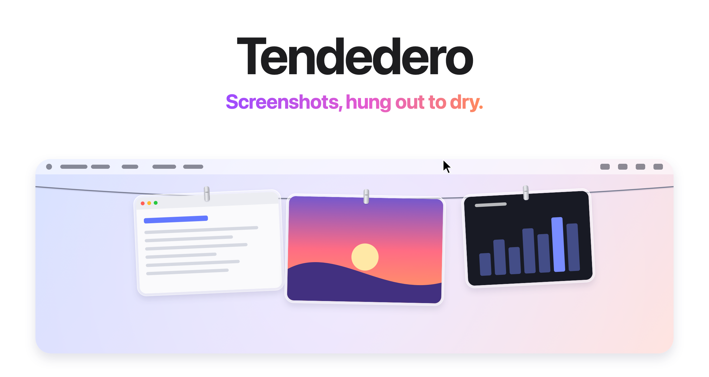

<picture>
  <source media="(prefers-color-scheme: dark)" srcset="docs/images/hero-dark.png">
  
</picture>

<h3 align="center"><a href="https://tendedero.app/?lang=en">Try it in your browser at tendedero.app&nbsp;&rsaquo;</a></h3>

<p align="center">
  Free and open source. For macOS 14 and later.
  <br>
  <a href="../../releases/latest">Download&nbsp;&rsaquo;</a>
  &nbsp;&nbsp;
  <a href="#build-from-source">Build from source&nbsp;&rsaquo;</a>
  <br><br>
  English&nbsp;·&nbsp;<a href="docs/i18n/README.es.md">Español</a>&nbsp;·&nbsp;<a href="docs/i18n/README.fr.md">Français</a>&nbsp;·&nbsp;<a href="docs/i18n/README.pt-BR.md">Português (Brasil)</a>&nbsp;·&nbsp;<a href="docs/i18n/README.ja.md">日本語</a>&nbsp;·&nbsp;<a href="docs/i18n/README.ko.md">한국어</a>&nbsp;·&nbsp;<a href="docs/i18n/README.zh-Hans.md">简体中文</a>
</p>

<br>

## Out of sight. Within reach.

Every screenshot you take hangs on a line just above your screen.
Rest the pointer in the menu bar and it glides down. Move away and it's gone.

<picture>
  <source media="(prefers-color-scheme: dark)" srcset="docs/images/demo-dark.gif">
  
</picture>

<br>
<br>

## A gesture for everything.

<picture>
  <source media="(prefers-color-scheme: dark)" srcset="docs/images/bento-dark.png">
  
</picture>

<br>
<br>

| | |
|:--|:--|
| Click | Copy the image. |
| Press and hold | Open the image editor; trim a recording. |
| Double click | Open the image editor; play a recording. |
| Hover and click Edit | Open Crop, Cut Out, Arrow, and Rectangle tools. |
| Force click | Take a quick look. |
| Drag into an app | Send a copy. It stays on the line. |
| Drag into a folder | Keep it there. It leaves the line. |
| Drag to the Trash, or click the cross | Let it go. |
| Rest the pointer in the menu bar | Bring the line down on that screen. |
| Click anything in the menu bar | Put it away. |
| <kbd>⌃</kbd>&thinsp;<kbd>⌥</kbd>&thinsp;<kbd>T</kbd> | Show or hide the line. Change it under Shortcut in the menu bar. |

<br>

## Your Desktop. Finally clear.

Hand Tendedero your screenshots<sup>1</sup> and they skip the Desktop
entirely. No floating thumbnail. No five-second wait. Each capture hangs
the instant you take it, and only what you drag out is kept.

Screen recordings hang there too, with a play button over them.
Press and hold one to trim it.

Same shortcuts. Same muscle memory. Just less mess.

<br>

## Copied images too.

Take a screenshot with <kbd>⌃</kbd> held, or copy an image in Preview, and it
hangs on the line like any other. Turn on Hang copied images in the menu bar
and the shirt fills in while it is on. Only images: anything copied along
with text or a file, and anything a password manager marks as private, is
left alone.

<br>

## Long pages. Shorter images.

Choose **Scrolling Capture…** in the menu bar, then drag around the scrollable
content. Choose **Vertical** or **Horizontal**, click **Start Capture**, and
scroll down or right. A live preview grows as new content is captured. Use
**Auto-scroll** to move the page in small steps; **Pause** stops it. Moving the
pointer outside the selected area also pauses Auto-scroll. Click **Done** to
save the preview as a PNG and open it in the image editor.

Select content inside one display, preferably leaving toolbars and scrollbars
outside. Matching tolerates small animations and stationary edges, and keeps
detected fixed headers and footers once. Views must still overlap. If matching
stalls, scroll back slightly to recover or click **Done** to save what the preview
shows. Large animations, repeated patterns, or layout changes may prevent a
reliable match. Avoid resizing or zooming the original window during capture.
Screen Recording access is required; Auto-scroll additionally needs macOS
Accessibility access. Manual scrolling works without Accessibility access.
Capture runs locally and omits the pointer and Tendedero's windows. Images are
limited to 80 million pixels and 32,768 pixels along either edge.

Hover over a screenshot and click **Edit**, double-click it, or use **Edit Latest
Image…** / **Open Image in Editor…** in the menu bar. The native editor offers
**Crop**, **Cut Out**, **Arrow**, and **Rectangle**, plus zoom, copy, and PNG export.
For Cut Out, choose **Horizontal** to remove rows and join the top and
bottom, or **Vertical** to remove columns and join the left and right.
Drag either way across the unwanted strip and click **Cut**. Repeat as needed;
**Undo** or **⌘Z** reverses the last edit. **Save Copy** hangs an edited PNG while
preserving the original. System **Markup** remains in the right-click menu for
additional annotation tools. Recordings retain their existing trimming action.

<br>

## Private by design.

No account. No network. No analytics.
Tendedero runs entirely on your Mac, and your screenshots never leave it.

<br>

## Tech Specs

| | |
|:--|:--|
| **Compatibility** | macOS 14 Sonoma or later, on Apple silicon and Intel. Designed for macOS 27. |
| **Size** | 1.7 MB |
| **Languages** | English, Spanish, French, Portuguese (Brazil), Japanese, Korean, Chinese (Simplified), Turkish, Azerbaijani |
| **Built with** | Swift, AppKit and SwiftUI |
| **Network access** | None |
| **Price** | Free |
| **License** | MIT for the code. The name and icon are not included. |

<br>

## Install

Download the disk image from the [latest release](../../releases/latest),
open it and drag Tendedero to Applications. Or install it with Homebrew:

```sh
brew install --cask alejandrobujan/tap/tendedero
```

Tendedero is signed with a Developer ID and notarized by Apple, so it opens
like any other app.

<br>

## Build from source

```sh
git clone git@github.com:alejandrobujan/tendedero.git
cd tendedero
scripts/build-app.sh
open build/Tendedero.app
```

Requires the Swift toolchain. Xcode is optional. With the Command Line Tools for macOS 27, the script falls back to the macOS 26 SDK they install alongside, because the new SDK needs a SwiftUI macro plugin only Xcode includes. Local builds use an available Developer ID identity, selected by certificate SHA to avoid duplicate-name ambiguity. Without an identity, they use ad hoc signing. macOS may request folder access again after an ad hoc rebuild.

To force ad hoc signing for a local test build, use
`SIGN_IDENTITY=- scripts/build-app.sh debug`.

<details>
<summary>Inside the app</summary>
<br>

| File | Role |
|:--|:--|
| `AppDelegate.swift` | Menu bar, shortcut, revealing and tucking away the line |
| `LinePanel.swift` | The transparent strip along the top of the screen |
| `LineView.swift` | The line and where each photo hangs |
| `PeggedView.swift` | One photo: glass frame, clip, swing and breeze |
| `GrabArea.swift` | Click, long press, drag and drop |
| `ScreenshotWatcher.swift` | Notices new screenshots |
| `ClipboardWatcher.swift` | Notices images copied to the clipboard |
| `Inbox.swift` | Takes over screenshot settings and puts them back |
| `Markup.swift` | Opens the system Markup editor and saves the result |
| `Trim.swift` | Trims a screen recording and saves the result |
| `ScrollingCapture.swift` | Selects a scrolling area, captures viewports, and joins them |
| `ImageEditor.swift` | Visible crop, cut-out, arrow, and rectangle tools; copy and export |
| `ImageGeometry.swift` | Pixel selection and overlap matching |
| `ImageEditing.swift` | Image decoding, lossless strip removal, joining, and PNG export |
| `FullScreen.swift` | Knows when to stay hidden |
| `Line.swift` | What is hanging, and what you can do with it |

Every image here, the icon included, is drawn in code by
`scripts/make-icon.swift` and `scripts/make-readme-art.swift`.
`scripts/make-dmg.sh` builds the disk image for releases.

Translations live in `Sources/Tendedero/Resources`, one `.lproj` folder per
language. `swift scripts/check-strings.swift` checks that none is missing.

Run `scripts/test-image-tools.sh` on macOS for the geometry, overlap, pixel order,
transparency, and PNG tests. On Linux, the same script runs the portable geometry
and overlap tests. Screen Recording permission and interaction with other apps
must be checked on a Mac; see [the manual checks](docs/image-tools-testing.md).

</details>

<br>

---

<sub>
1. On first launch, Tendedero offers to handle your screenshots. If you accept, it turns off the floating thumbnail and saves new screenshots to its own folder, two settings also found under Options in Cmd+Shift+5. Your previous settings are saved and restored when Tendedero quits or the option is turned off from the menu bar. Tendedero hides automatically while an app is in full screen.
</sub>

<br>
<br>

<p align="center">
  
  <br>
  <sub>The code is MIT licensed. The Tendedero name and icon are not, so forks need their own. See <a href="LICENSE">LICENSE</a>.</sub>
  <br>
  <sub>Designed and built by <a href="https://alejandrobujan.com">Alejandro Buján</a>.</sub>
</p>
