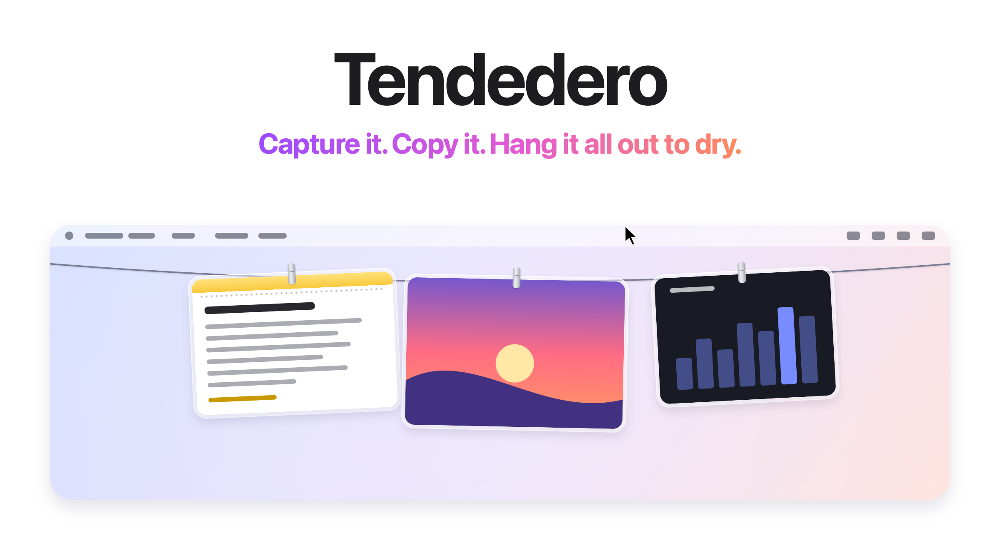
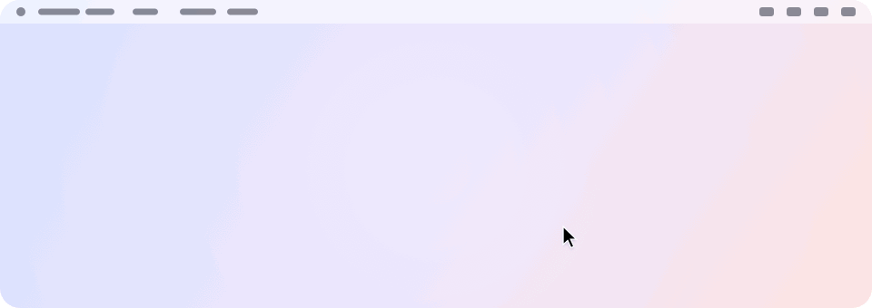
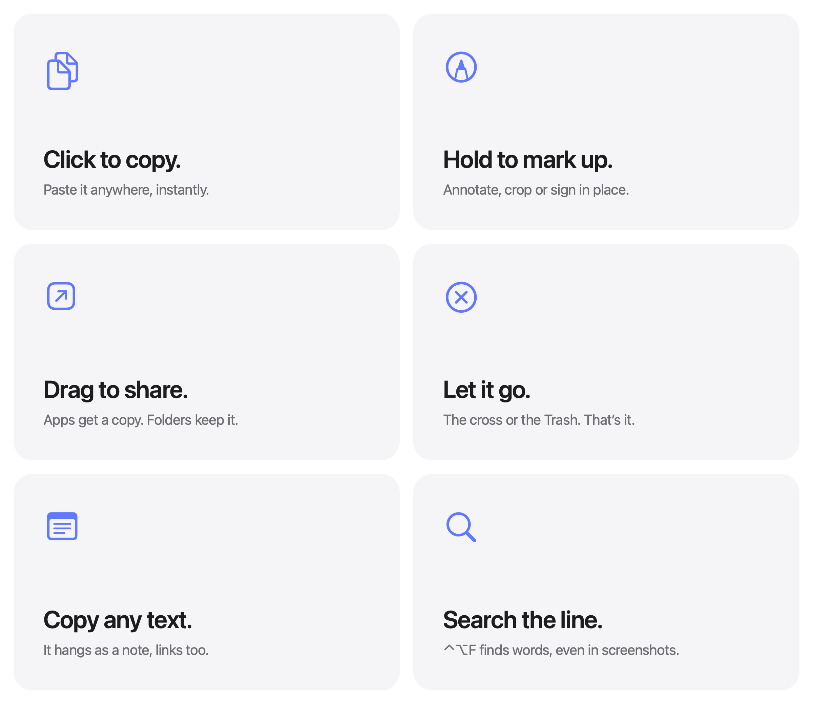

<picture>
  <source media="(prefers-color-scheme: dark)" srcset="docs/images/hero-dark.png">
  
</picture>

<h3 align="center"><a href="https://tendedero.app/?lang=en">Try it in your browser at tendedero.app&nbsp;&rsaquo;</a></h3>

<p align="center">
  Free and open source. For macOS 14 and later.
  <br>
  <a href="../../releases/latest">Download&nbsp;&rsaquo;</a>
  &nbsp;&nbsp;
  <a href="#build-from-source">Build from source&nbsp;&rsaquo;</a>
  <br><br>
  English&nbsp;·&nbsp;<a href="docs/i18n/README.es.md">Español</a>&nbsp;·&nbsp;<a href="docs/i18n/README.gl.md">Galego</a>&nbsp;·&nbsp;<a href="docs/i18n/README.fr.md">Français</a>&nbsp;·&nbsp;<a href="docs/i18n/README.pt-BR.md">Português (Brasil)</a>&nbsp;·&nbsp;<a href="docs/i18n/README.it.md">Italiano</a>&nbsp;·&nbsp;<a href="docs/i18n/README.ja.md">日本語</a>&nbsp;·&nbsp;<a href="docs/i18n/README.ko.md">한국어</a>&nbsp;·&nbsp;<a href="docs/i18n/README.zh-Hans.md">简体中文</a>&nbsp;·&nbsp;<a href="docs/i18n/README.tr.md">Türkçe</a>&nbsp;·&nbsp;<a href="docs/i18n/README.az.md">Azərbaycanca</a>&nbsp;·&nbsp;<a href="docs/i18n/README.hi.md">हिन्दी</a>&nbsp;·&nbsp;<a href="docs/i18n/README.vi.md">Tiếng Việt</a>
</p>

<p align="center">
  <a href="https://trendshift.io/repositories/287033?utm_source=trendshift-badge&amp;utm_medium=badge&amp;utm_campaign=badge-trendshift-287033" target="_blank" rel="noopener noreferrer"></a>
  <a href="https://trendshift.io/repositories/287033?utm_source=trendshift-badge&amp;utm_medium=badge&amp;utm_campaign=badge-trendshift-287033" target="_blank" rel="noopener noreferrer"></a>
</p>

<br>

## Out of sight. Within reach.

Every screenshot you take, and anything you copy, hangs on a line just above your screen.
Rest the pointer in the middle of the menu bar and it glides down. Move away and it's gone.

<picture>
  <source media="(prefers-color-scheme: dark)" srcset="docs/images/demo-dark.gif">
  
</picture>

<br>
<br>

## A gesture for everything.

<picture>
  <source media="(prefers-color-scheme: dark)" srcset="docs/images/bento-dark.png">
  
</picture>

<br>
<br>

| | |
|:--|:--|
| Click | Copy it. A note copies its text, styled as it was. |
| Press and hold | Open it in Markup. A note opens to edit. |
| Double click | Open it in Preview. A link opens in your browser. |
| Force click | Take a quick look. |
| Drag into an app | Send a copy. It stays on the line. |
| Drag into a folder | Keep it there. It leaves the line. |
| Drag to the Trash, or click the cross | Let it go. |
| Shift-click | Select several. Their menu, <kbd>⌘</kbd>&thinsp;<kbd>C</kbd>, <kbd>⌫</kbd> and a drag act on them all. <kbd>Esc</kbd> or a plain click clears it. |
| <kbd>⌘</kbd>&thinsp;<kbd>Z</kbd> with the pointer on the line | Undo what you just did: let go, pin or save to the Desktop, a whole selection included. |
| <kbd>Space</kbd> with the pointer on a photo | Take a quick look. |
| <kbd>⌫</kbd> with the pointer on a photo | Let it go, as its corner button does. |
| Right click, then Share | Send it with AirDrop, Messages, Mail and more. It stays on the line. |
| Right click, then Pin | Keep it: it hangs left of the knot on a space grey clip, and no new screenshot pushes it off. |
| Right click, then Hold | Take it off the line and keep it in front of you while you work. A held note is text you can select. |
| In Finder, right click an image or a text file, then Hang on Tendedero | Hang it on the line, pinned. |
| Rest the pointer on a photo, with Zoom on hover on | See it larger in the middle of the screen. |
| Rest the pointer in the middle of the menu bar | Bring the line down on that screen. |
| Click anything in the menu bar | Put it away. |
| <kbd>⌃</kbd>&thinsp;<kbd>⌥</kbd>&thinsp;<kbd>T</kbd> | Show or hide the line. Change it under Shortcut in the menu bar. |
| <kbd>⌃</kbd>&thinsp;<kbd>⌥</kbd>&thinsp;<kbd>F</kbd> | Search the line. |

<br>

## Your Desktop. Finally clear.

Hand Tendedero your screenshots<sup>1</sup> and they skip the Desktop
entirely. No floating thumbnail. No five-second wait. Each capture hangs
the instant you take it, and only what you drag out is kept.

Screen recordings hang there too, with a play button over them.
Press and hold one to trim it.

Same shortcuts. Same muscle memory. Just less mess.

<br>

## Copied text, links and images too.

Turn them on one by one under Hang what you copy in the menu bar, and the
shirt fills in while any is on.

Copied text hangs as a note, a sheet from Notes in the same glass frame:
the first line is its title, Markdown shows formatted and code keeps its
lines. A web address hangs as a link, with its site and path. Take a
screenshot with <kbd>⌃</kbd> held, or copy an image in Preview, and it hangs
like any other.

Nothing is kept from a password field, from what a password manager marks
as private, or from another device through Universal Clipboard.

<br>

## Find anything on the line.

Press <kbd>⌃</kbd>&thinsp;<kbd>⌥</kbd>&thinsp;<kbd>F</kbd> and type. Only what
matches stays on the line: the words in a screenshot, read on your Mac
the moment it hangs, and the words of every note and link.
<kbd>Return</kbd> copies the newest match.

<br>

## Private by design.

No account. No network. No analytics.
Tendedero runs entirely on your Mac, reading text in screenshots included,
and nothing you hang ever leaves it.

<br>

## Tech Specs

| | |
|:--|:--|
| **Compatibility** | macOS 14 Sonoma or later, on Apple silicon and Intel. Designed for macOS 27. |
| **Size** | 3.5 MB |
| **Languages** | English, Spanish, Galician, French, Portuguese (Brazil), Italian, Japanese, Korean, Chinese (Simplified), Turkish, Azerbaijani, Hindi, Vietnamese |
| **Built with** | Swift, AppKit and SwiftUI |
| **Network access** | None |
| **Price** | Free |
| **License** | MIT for the code. The name and icon are not included. |

<br>

## Install

Download the disk image from the [latest release](../../releases/latest),
open it and drag Tendedero to Applications. Or install it with Homebrew:

```sh
brew install tendedero
```

Tendedero is signed with a Developer ID and notarized by Apple, so it opens
like any other app.

<br>

## Build from source

```sh
git clone git@github.com:alejandrobujan/tendedero.git
cd tendedero
scripts/build-app.sh
open build/Tendedero.app
```

Requires the Swift toolchain. Xcode is optional. With the Command Line Tools for macOS 27, the script falls back to the macOS 26 SDK they install alongside, because the new SDK needs a SwiftUI macro plugin only Xcode includes. Local builds are signed ad hoc,
so macOS asks again for access to the Desktop after each rebuild.

Want to help? Read [CONTRIBUTING.md](CONTRIBUTING.md) first.

<details>
<summary>Inside the app</summary>
<br>

| File | Role |
|:--|:--|
| `AppDelegate.swift` | Menu bar, shortcut, revealing and tucking away the line |
| `LinePanel.swift` | The transparent strip along the top of the screen |
| `LineView.swift` | The line and where each photo hangs |
| `PeggedView.swift` | One photo or note: glass frame, clip, swing and breeze |
| `GrabArea.swift` | Click, long press, drag and drop |
| `ScreenshotWatcher.swift` | Notices new screenshots |
| `ClipboardWatcher.swift` | Notices images, text and links copied to the clipboard |
| `NoteSheet.swift` | Copied text drawn as a sheet from Notes |
| `Markdown.swift` | Markdown in notes |
| `Inbox.swift` | Takes over screenshot settings and puts them back |
| `Markup.swift` | Opens the system Markup editor and saves the result |
| `Trim.swift` | Trims a screen recording and saves the result |
| `FullScreen.swift` | Knows when to stay hidden |
| `Line.swift` | What is hanging, and what you can do with it |
| `Held.swift` | A photo held in front of you, off the line |
| `SearchIndex.swift` | Reads the text in screenshots, on this Mac, for search |
| `SearchBar.swift` | The search field under the line |
| `Zoom.swift` | A larger copy of a photo on hover |
| `Share.swift` | Share, from a photo's menu |

Every image here, the icon included, is drawn in code by
`scripts/make-icon.swift` and `scripts/make-readme-art.swift`.
`scripts/make-dmg.sh` builds the disk image for releases.

Translations live in `Sources/Tendedero/Resources`, one `.lproj` folder per
language. `swift scripts/check-strings.swift` checks that none is missing.

</details>

<br>

---

<sub>
1. On first launch, Tendedero offers to handle your screenshots. If you accept, it turns off the floating thumbnail and saves new screenshots to its own folder, two settings also found under Options in Cmd+Shift+5. Your previous settings are saved and restored when Tendedero quits or the option is turned off from the menu bar. Tendedero hides automatically while an app is in full screen.
</sub>

<br>
<br>

<p align="center">
  
  <br>
  <sub>The code is MIT licensed. The Tendedero name and icon are not, so forks need their own. See <a href="LICENSE">LICENSE</a>.</sub>
  <br>
  <sub>Designed and built by <a href="https://alejandrobujan.com">Alejandro Buján</a>.</sub>
</p>
