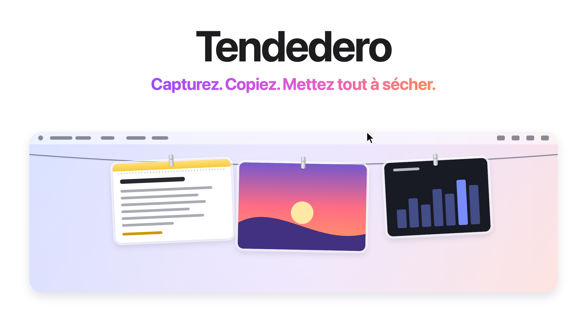
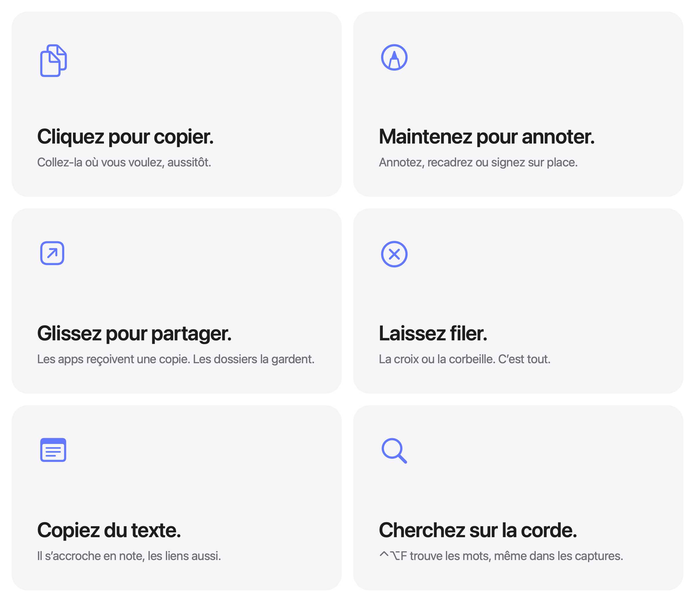

<picture>
  <source media="(prefers-color-scheme: dark)" srcset="../images/fr/hero-dark.png">
  
</picture>

<h3 align="center"><a href="https://tendedero.app/?lang=fr">Essayez-le dans votre navigateur sur tendedero.app&nbsp;&rsaquo;</a></h3>

<p align="center">
  Gratuit et open source. Pour macOS 14 et versions ultérieures.
  <br>
  <a href="../../../../releases/latest">Télécharger&nbsp;&rsaquo;</a>
  &nbsp;&nbsp;
  <a href="#compiler-depuis-le-code-source">Compiler depuis le code source&nbsp;&rsaquo;</a>
  <br><br>
  <a href="../../README.md">English</a>&nbsp;·&nbsp;<a href="README.es.md">Español</a>&nbsp;·&nbsp;<a href="README.gl.md">Galego</a>&nbsp;·&nbsp;Français&nbsp;·&nbsp;<a href="README.pt-BR.md">Português (Brasil)</a>&nbsp;·&nbsp;<a href="README.it.md">Italiano</a>&nbsp;·&nbsp;<a href="README.ja.md">日本語</a>&nbsp;·&nbsp;<a href="README.ko.md">한국어</a>&nbsp;·&nbsp;<a href="README.zh-Hans.md">简体中文</a>&nbsp;·&nbsp;<a href="README.tr.md">Türkçe</a>&nbsp;·&nbsp;<a href="README.az.md">Azərbaycanca</a>&nbsp;·&nbsp;<a href="README.hi.md">हिन्दी</a>&nbsp;·&nbsp;<a href="README.vi.md">Tiếng Việt</a>
  <br>
  <sub>Traduction du README anglais. En cas de différence, l’anglais fait foi.</sub>
</p>

<p align="center">
  <a href="https://trendshift.io/repositories/287033?utm_source=trendshift-badge&amp;utm_medium=badge&amp;utm_campaign=badge-trendshift-287033" target="_blank" rel="noopener noreferrer"></a>
  <a href="https://trendshift.io/repositories/287033?utm_source=trendshift-badge&amp;utm_medium=badge&amp;utm_campaign=badge-trendshift-287033" target="_blank" rel="noopener noreferrer"></a>
</p>

<br>

## Hors de vue. À portée de main.

Chaque capture d’écran que vous prenez, et tout ce que vous copiez, s’accroche à une corde juste au-dessus de l’écran.
Posez le pointeur au milieu de la barre des menus et la corde descend. Éloignez-le et elle disparaît.

<picture>
  <source media="(prefers-color-scheme: dark)" srcset="../images/fr/demo-dark.gif">
  
</picture>

<br>
<br>

## Un geste pour chaque chose.

<picture>
  <source media="(prefers-color-scheme: dark)" srcset="../images/fr/bento-dark.png">
  
</picture>

<br>
<br>

| | |
|:--|:--|
| Clic | Copie l’élément. Une note copie son texte, avec sa mise en forme. |
| Clic maintenu | L’ouvre dans Annotation. Une note s’ouvre pour être modifiée. |
| Double-clic | L’ouvre dans Aperçu. Un lien s’ouvre dans votre navigateur. |
| Clic forcé | Un Coup d’œil rapide. |
| Glisser dans une app | Envoie une copie. Elle reste sur la corde. |
| Glisser dans un dossier | Elle y reste. Elle quitte la corde. |
| Glisser dans la corbeille, ou cliquer sur la croix | Laissez-la filer. |
| Maj-clic | Sélectionne plusieurs éléments. Leur menu, <kbd>⌘</kbd>&thinsp;<kbd>C</kbd>, <kbd>⌫</kbd> et un glissement agissent sur tous. <kbd>Échap</kbd> ou un simple clic annule la sélection. |
| <kbd>⌘</kbd>&thinsp;<kbd>Z</kbd>, le pointeur sur la corde | Annule ce que vous venez de faire : laisser filer, épingler ou enregistrer sur le bureau, sélection entière comprise. |
| <kbd>Espace</kbd>, le pointeur sur une photo | Jetez-y un coup d’œil. |
| <kbd>⌫</kbd>, le pointeur sur une photo | Laissez-la filer, comme son bouton d’angle. |
| Clic droit, puis Partager | L’envoie par AirDrop, Messages, Mail et plus. Elle reste sur la corde. |
| Clic droit, puis Épingler | Gardez-la : elle pend à gauche du nœud avec une pince gris sidéral, et aucune nouvelle capture ne la pousse. |
| Clic droit, puis Garder en main | Décrochez-la et gardez-la devant vous pendant que vous travaillez. Une note gardée en main est du texte que vous pouvez sélectionner. |
| Dans le Finder, clic droit sur une image ou un fichier texte, puis Accrocher dans Tendedero | Accrochez-le à la corde, épinglé. |
| Poser le pointeur sur une photo, avec Agrandir au survol activé | L’affiche en plus grand au milieu de l’écran. |
| Poser le pointeur au milieu de la barre des menus | Fait descendre la corde sur cet écran. |
| Cliquer n’importe où dans la barre des menus | La range. |
| <kbd>⌃</kbd>&thinsp;<kbd>⌥</kbd>&thinsp;<kbd>T</kbd> | Affiche ou masque la corde. Modifiable dans Raccourci, dans la barre des menus. |
| <kbd>⌃</kbd>&thinsp;<kbd>⌥</kbd>&thinsp;<kbd>F</kbd> | Recherche sur la corde. |

<br>

## Votre bureau, enfin dégagé.

Confiez vos captures à Tendedero<sup>1</sup> et elles ne passent plus par le
bureau. Pas de vignette flottante. Pas cinq secondes d’attente. Chaque capture
s’accroche à l’instant où vous la prenez, et seul ce que vous en sortez est gardé.

Les enregistrements d’écran s’accrochent aussi, avec un bouton de lecture
par-dessus. Maintenez le clic sur l’un d’eux pour le raccourcir.

Les mêmes raccourcis. Les mêmes réflexes. Juste moins de désordre.

<br>

## Le texte, les liens et les images copiés aussi.

Activez-les un par un dans Accrocher ce que vous copiez, dans la barre des
menus ; le t-shirt se remplit tant que l’un d’eux est actif.

Le texte copié s’accroche comme une note, une feuille de Notes dans le même
cadre en verre : la première ligne en est le titre, le Markdown s’affiche mis
en forme et le code garde ses lignes. Une adresse web s’accroche comme un lien,
avec son site et son chemin. Prenez une capture en maintenant <kbd>⌃</kbd>, ou
copiez une image dans Aperçu, et elle s’accroche comme les autres.

Rien n’est gardé d’un champ de mot de passe, de ce qu’un gestionnaire de mots
de passe marque comme privé, ni d’un autre appareil via le Presse-papiers
universel.

<br>

## Trouvez tout sur la corde.

Appuyez sur <kbd>⌃</kbd>&thinsp;<kbd>⌥</kbd>&thinsp;<kbd>F</kbd> et tapez. Seul
ce qui correspond reste sur la corde : les mots d’une capture, lus sur votre Mac
dès qu’elle s’accroche, et ceux de chaque note et de chaque lien.
<kbd>Retour</kbd> copie la correspondance la plus récente.

<br>

## Privé par nature.

Pas de compte. Pas de réseau. Pas de statistiques.
Tendedero fonctionne entièrement sur votre Mac, lecture du texte des captures comprise,
et rien de ce que vous accrochez ne le quitte jamais.

<br>

## Caractéristiques techniques

| | |
|:--|:--|
| **Compatibilité** | macOS 14 Sonoma ou version ultérieure, sur Mac Apple silicon et Intel. Conçu pour macOS 27. |
| **Taille** | 3,5 Mo |
| **Langues** | Anglais, espagnol, galicien, français, portugais du Brésil, italien, japonais, coréen, chinois simplifié, turc, azerbaïdjanais, hindi et vietnamien |
| **Conçu avec** | Swift, AppKit et SwiftUI |
| **Accès au réseau** | Aucun |
| **Prix** | Gratuit |
| **Licence** | MIT pour le code. Le nom et l’icône ne sont pas inclus. |

<br>

## Installation

Téléchargez l’image disque depuis la [dernière version](../../../../releases/latest),
ouvrez-la et glissez Tendedero dans Applications. Ou installez-le avec Homebrew :

```sh
brew install tendedero
```

Tendedero est signé avec un Developer ID et notarié par Apple : il s’ouvre
comme n’importe quelle autre app.

<br>

## Compiler depuis le code source

```sh
git clone git@github.com:alejandrobujan/tendedero.git
cd tendedero
scripts/build-app.sh
open build/Tendedero.app
```

Il suffit des outils Swift ; Xcode est facultatif. Avec les Command Line Tools
de macOS 27, le script se rabat sur le SDK de macOS 26 installé avec elles, car
le nouveau SDK a besoin d’un plug-in de macros SwiftUI fourni uniquement avec
Xcode. Les compilations locales sont signées ad hoc : macOS redemande donc
l’accès au bureau après chaque recompilation.

<details>
<summary>Sous le capot</summary>
<br>

| Fichier | Rôle |
|:--|:--|
| `AppDelegate.swift` | La barre des menus, le raccourci, faire descendre et ranger la corde |
| `LinePanel.swift` | La bande transparente le long du haut de l’écran |
| `LineView.swift` | La corde et l’endroit où pend chaque photo |
| `PeggedView.swift` | Une photo ou une note : cadre en verre, pince, balancement et brise |
| `GrabArea.swift` | Clic, clic maintenu, glisser-déposer |
| `ScreenshotWatcher.swift` | Repère les nouvelles captures |
| `ClipboardWatcher.swift` | Repère les images, le texte et les liens copiés dans le presse-papiers |
| `NoteSheet.swift` | Le texte copié, dessiné comme une feuille de Notes |
| `Markdown.swift` | Le Markdown dans les notes |
| `Inbox.swift` | Prend en charge les réglages de capture et les rétablit |
| `Markup.swift` | Ouvre l’éditeur Annotation du système et enregistre le résultat |
| `Trim.swift` | Raccourcit un enregistrement d’écran et enregistre le résultat |
| `FullScreen.swift` | Sait quand rester caché |
| `Line.swift` | Ce qui est accroché, et ce que vous pouvez en faire |
| `Held.swift` | Une photo gardée en main devant vous, hors de la corde |
| `SearchIndex.swift` | Lit le texte des captures, sur ce Mac, pour la recherche |
| `SearchBar.swift` | Le champ de recherche sous la corde |
| `Zoom.swift` | Une copie agrandie d’une photo au survol |
| `Share.swift` | Partager, depuis le menu d’une photo |

Toutes les images de cette page, icône comprise, sont dessinées en code par
`scripts/make-icon.swift` et `scripts/make-readme-art.swift`.
`scripts/make-dmg.sh` crée l’image disque de chaque version.

Les traductions se trouvent dans `Sources/Tendedero/Resources`, un dossier
`.lproj` par langue. `swift scripts/check-strings.swift` vérifie qu’aucune ne manque.

</details>

<br>

---

<sub>
1. Au premier lancement, Tendedero propose de gérer vos captures d’écran. Si vous acceptez, il désactive la vignette flottante et enregistre les nouvelles captures dans son propre dossier, deux réglages que l’on trouve aussi dans Options de Cmd+Maj+5. Vos réglages précédents sont conservés et rétablis quand vous quittez Tendedero ou désactivez l’option depuis la barre des menus. Tendedero se masque automatiquement quand une app est en plein écran.
</sub>

<br>
<br>

<p align="center">
  
  <br>
  <sub>Le code est sous licence MIT. Le nom et l’icône de Tendedero ne le sont pas : chaque fork a besoin des siens. Voir <a href="../../LICENSE">LICENSE</a>.</sub>
  <br>
  <sub>Conçu et développé par <a href="https://alejandrobujan.com">Alejandro Buján</a>.</sub>
</p>
