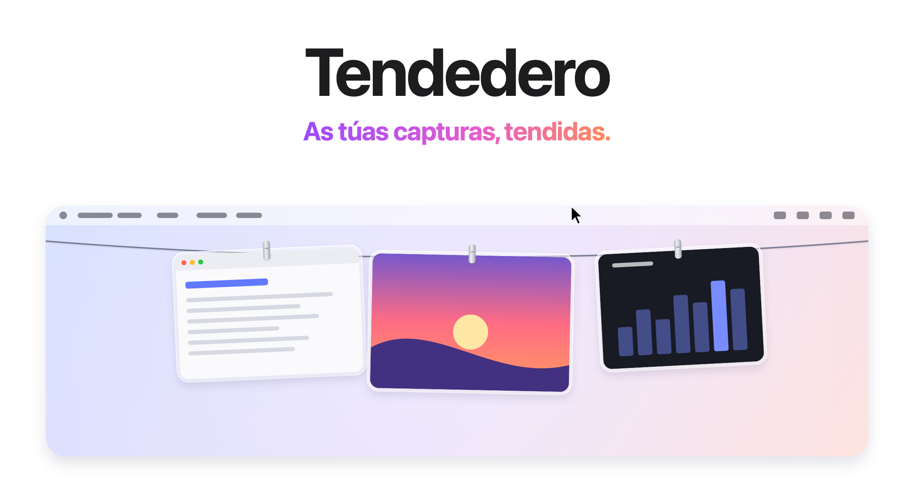
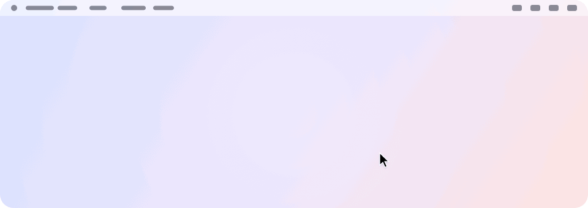
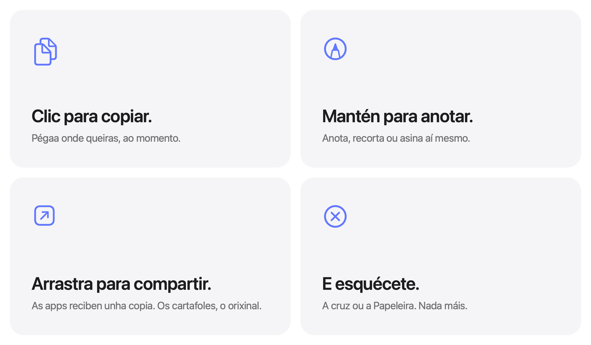

<picture>
  <source media="(prefers-color-scheme: dark)" srcset="../images/gl/hero-dark.png">
  
</picture>

<h3 align="center"><a href="https://tendedero.app/?lang=gl">Próbaa dende o navegador en tendedero.app&nbsp;&rsaquo;</a></h3>

<p align="center">
  De balde e de código aberto. Para macOS 14 ou posterior.
  <br>
  <a href="../../../../releases/latest">Descargar&nbsp;&rsaquo;</a>
  &nbsp;&nbsp;
  <a href="#compilar-dende-o-código">Compilar dende o código&nbsp;&rsaquo;</a>
  <br><br>
  <a href="../../README.md">English</a>&nbsp;·&nbsp;<a href="README.es.md">Español</a>&nbsp;·&nbsp;Galego&nbsp;·&nbsp;<a href="README.fr.md">Français</a>&nbsp;·&nbsp;<a href="README.pt-BR.md">Português (Brasil)</a>&nbsp;·&nbsp;<a href="README.ja.md">日本語</a>&nbsp;·&nbsp;<a href="README.ko.md">한국어</a>&nbsp;·&nbsp;<a href="README.zh-Hans.md">简体中文</a>&nbsp;·&nbsp;<a href="README.tr.md">Türkçe</a>&nbsp;·&nbsp;<a href="README.az.md">Azərbaycanca</a>&nbsp;·&nbsp;<a href="README.hi.md">हिन्दी</a>
  <br>
  <sub>Tradución do README en inglés. Se algo non coincide, manda o inglés.</sub>
</p>

<p align="center">
  <a href="https://trendshift.io/repositories/287033?utm_source=trendshift-badge&amp;utm_medium=badge&amp;utm_campaign=badge-trendshift-287033" target="_blank" rel="noopener noreferrer"></a>
  <a href="https://trendshift.io/repositories/287033?utm_source=trendshift-badge&amp;utm_medium=badge&amp;utm_campaign=badge-trendshift-287033" target="_blank" rel="noopener noreferrer"></a>
</p>

<br>

## Fóra da vista. Sempre a man.

Cada captura que fas queda pendurada nunha corda xusto enriba da pantalla.
Leva o punteiro á barra de menús e a corda baixa. Apártao e desaparece.

<picture>
  <source media="(prefers-color-scheme: dark)" srcset="../images/gl/demo-dark.gif">
  
</picture>

<br>
<br>

## Un xesto para cada cousa.

<picture>
  <source media="(prefers-color-scheme: dark)" srcset="../images/gl/bento-dark.png">
  
</picture>

<br>
<br>

| | |
|:--|:--|
| Clic | Copia a imaxe. |
| Manter premido | Ábrea en Marcación. |
| Dobre clic | Ábrea en Vista Previa. |
| Clic forte | Bótalle unha ollada con Vista Rápida. |
| Arrastrar a unha app | Envía unha copia, e a captura segue pendurada. |
| Arrastrar a un cartafol | Queda alí e sae da corda. |
| Arrastrar á Papeleira ou facer clic na cruz | Desfaste dela. |
| Deixar o punteiro na barra de menús | Baixa a corda nesa pantalla. |
| Facer clic en calquera sitio da barra de menús | Recolle a corda. |
| <kbd>⌃</kbd>&thinsp;<kbd>⌥</kbd>&thinsp;<kbd>T</kbd> | Amosa ou oculta a corda. Cámbiase en Atallo, na barra de menús. |

<br>

## O teu Escritorio, por fin despexado.

Deixa que Tendedero se encargue das túas capturas<sup>1</sup> e deixarán de pasar
polo Escritorio. Sen miniatura flotante nin cinco segundos de espera: cada
captura pendúrase ao momento, e só queda o que ti saques da corda.

As gravacións de pantalla tamén se penduran, cun botón de reprodución enriba.
Mantén premida unha para recortala.

Os mesmos atallos e os mesmos costumes. Pero sen desorde.

<br>

## Tamén as imaxes que copias.

Fai unha captura con <kbd>⌃</kbd> premido, ou copia unha imaxe en Vista Previa,
e pendúrase coma calquera outra. Activa Pendurar imaxes copiadas na barra de
menús; mentres está activo, a camiseta énchese. Só imaxes: o que se copia
xunto con texto ou un ficheiro, e o que un xestor de contrasinais marca como
privado, déixase tal cal.

<br>

## Privacidade de serie.

Sen contas, sen conexión a internet, sen analíticas.
Tendedero funciona só no teu Mac, e as túas capturas nunca saen del.

<br>

## Especificacións técnicas

| | |
|:--|:--|
| **Compatibilidade** | macOS 14 Sonoma ou posterior, en Mac con Apple silicon ou Intel. Pensado para macOS 27. |
| **Tamaño** | 1,7 MB |
| **Idiomas** | Inglés, español, galego, francés, portugués do Brasil, xaponés, coreano, chinés simplificado, turco, acerbaixano e hindi |
| **Feito con** | Swift, AppKit e SwiftUI |
| **Conexión a internet** | Non a usa |
| **Prezo** | De balde |
| **Licenza** | MIT para o código. O nome e a icona quedan fóra. |

<br>

## Instalación

Descarga a imaxe de disco dende a [última versión](../../../../releases/latest),
ábrea e arrastra Tendedero a Aplicacións. Tamén podes instalalo con Homebrew:

```sh
brew install --cask alejandrobujan/tap/tendedero
```

Tendedero está asinado cun Developer ID e notarizado por Apple, así que se
abre coma calquera outra app.

<br>

## Compilar dende o código

```sh
git clone git@github.com:alejandrobujan/tendedero.git
cd tendedero
scripts/build-app.sh
open build/Tendedero.app
```

Só precisas as ferramentas de Swift; Xcode é opcional. Se usas as Command
Line Tools de macOS 27, o script tira do SDK de macOS 26 que se instala con
elas, porque o novo precisa un plugin de macros de SwiftUI que só vén con
Xcode. As compilacións locais asínanse ad hoc, así que macOS volve pedir
acceso ao Escritorio cada vez que recompilas.

<details>
<summary>Por dentro</summary>
<br>

| Ficheiro | Que fai |
|:--|:--|
| `AppDelegate.swift` | A barra de menús, o atallo, e baixar e recoller a corda |
| `LinePanel.swift` | A franxa transparente do bordo superior da pantalla |
| `LineView.swift` | A corda e onde pendura cada foto |
| `PeggedView.swift` | Cada foto: marco de cristal, pinza, abaneo e brisa |
| `GrabArea.swift` | Clic, pulsación longa, e arrastrar e soltar |
| `ScreenshotWatcher.swift` | Decátase das capturas novas |
| `ClipboardWatcher.swift` | Decátase das imaxes copiadas |
| `Inbox.swift` | Toma o control dos axustes de captura e logo devólveos |
| `Markup.swift` | Abre o editor de Marcación do sistema e garda o resultado |
| `Trim.swift` | Recorta unha gravación de pantalla e garda o resultado |
| `FullScreen.swift` | Sabe cando ten que quedar oculto |
| `Line.swift` | Que hai pendurado e que podes facer con iso |

Todas as imaxes desta páxina, icona incluída, debúxanse con código en
`scripts/make-icon.swift` e `scripts/make-readme-art.swift`.
`scripts/make-dmg.sh` xera a imaxe de disco de cada versión.

As traducións están en `Sources/Tendedero/Resources`, cun cartafol `.lproj`
por idioma. `swift scripts/check-strings.swift` avisa se falta algunha.

</details>

<br>

---

<sub>
1. A primeira vez que o abres, Tendedero ofrécese a encargarse das túas capturas. Se aceptas, desactiva a miniatura flotante e garda as capturas novas no seu propio cartafol; son dous axustes que tamén atoparás en Opcións de Cmd+Maiús+5. Os teus axustes anteriores gárdanse e volven ao seu sitio ao pechar Tendedero ou ao desactivar a opción dende a barra de menús. Mentres unha app está a pantalla completa, Tendedero ocúltase só.
</sub>

<br>
<br>

<p align="center">
  
  <br>
  <sub>O código ten licenza MIT, pero o nome e a icona de Tendedero non, así que cada fork precisa os seus. Máis detalles en <a href="../../LICENSE">LICENSE</a>.</sub>
  <br>
  <sub>Deseñado e desenvolvido por <a href="https://alejandrobujan.com">Alejandro Buján</a>.</sub>
</p>
