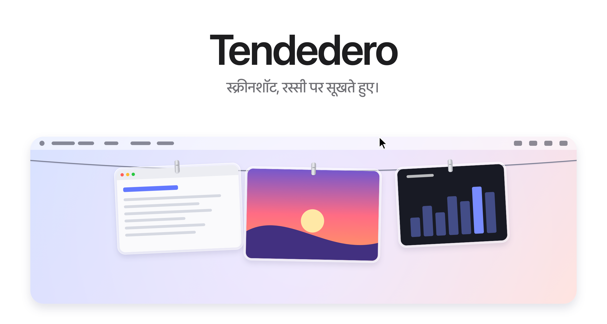
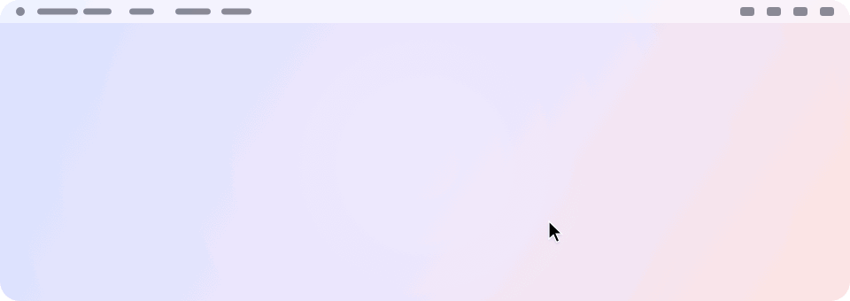
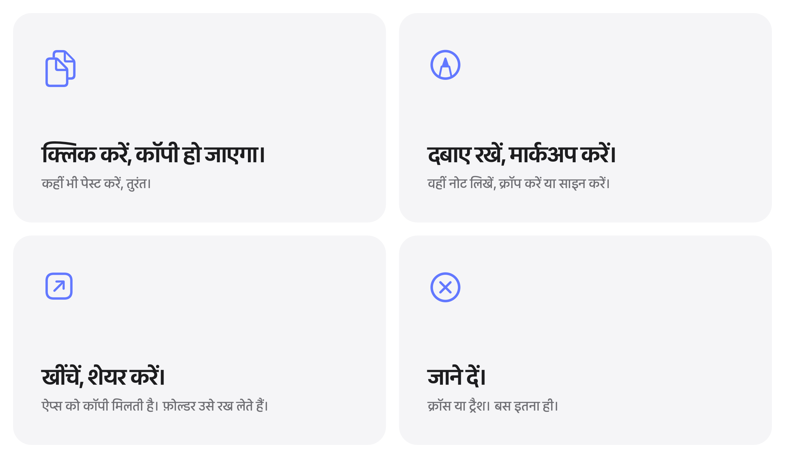

<picture>
  <source media="(prefers-color-scheme: dark)" srcset="../images/hi/hero-dark.png">
  
</picture>

<h3 align="center"><a href="https://tendedero.app">tendedero.app पर अपने ब्राउज़र में आज़माएँ&nbsp;&rsaquo;</a></h3>

<p align="center">
  मुफ़्त और ओपन सोर्स। macOS 14 और उसके बाद के लिए।
  <br>
  <a href="../../../../releases/latest">डाउनलोड करें&nbsp;&rsaquo;</a>
  &nbsp;&nbsp;
  <a href="#सोर्स-से-बनाएँ">सोर्स से बनाएँ&nbsp;&rsaquo;</a>
  <br><br>
  <a href="../../README.md">English</a>&nbsp;·&nbsp;<a href="README.es.md">Español</a>&nbsp;·&nbsp;<a href="README.gl.md">Galego</a>&nbsp;·&nbsp;<a href="README.fr.md">Français</a>&nbsp;·&nbsp;<a href="README.pt-BR.md">Português (Brasil)</a>&nbsp;·&nbsp;<a href="README.ja.md">日本語</a>&nbsp;·&nbsp;<a href="README.ko.md">한국어</a>&nbsp;·&nbsp;<a href="README.zh-Hans.md">简体中文</a>&nbsp;·&nbsp;<a href="README.tr.md">Türkçe</a>&nbsp;·&nbsp;<a href="README.az.md">Azərbaycanca</a>&nbsp;·&nbsp;हिन्दी
  <br>
  <sub>अंग्रेज़ी README का अनुवाद। कहीं फ़र्क़ हो तो अंग्रेज़ी वाला ही मान्य है।</sub>
</p>

<p align="center">
  <a href="https://trendshift.io/repositories/287033?utm_source=trendshift-badge&amp;utm_medium=badge&amp;utm_campaign=badge-trendshift-287033" target="_blank" rel="noopener noreferrer"></a>
  <a href="https://trendshift.io/repositories/287033?utm_source=trendshift-badge&amp;utm_medium=badge&amp;utm_campaign=badge-trendshift-287033" target="_blank" rel="noopener noreferrer"></a>
</p>

<br>

## नज़र से दूर। हमेशा पास।

आप जो भी स्क्रीनशॉट लेते हैं, वह आपकी स्क्रीन के ठीक ऊपर एक रस्सी पर टँग जाता है।
पॉइंटर को मेनू बार में रोकें और रस्सी धीरे से नीचे आ जाती है। पॉइंटर हटाएँ और वह गायब।

<picture>
  <source media="(prefers-color-scheme: dark)" srcset="../images/hi/demo-dark.gif">
  
</picture>

<br>
<br>

## हर काम के लिए एक इशारा।

<picture>
  <source media="(prefers-color-scheme: dark)" srcset="../images/hi/bento-dark.png">
  
</picture>

<br>
<br>

| | |
|:--|:--|
| क्लिक | तस्वीर कॉपी करें। |
| दबाए रखें | उसे मार्कअप में खोलें। |
| डबल क्लिक | उसे Preview में खोलें। |
| फ़ोर्स क्लिक | क्विक लुक से झाँकें। |
| किसी ऐप में खींचें | एक कॉपी भेजें। वह रस्सी पर बनी रहती है। |
| किसी फ़ोल्डर में खींचें | उसे वहीं रखें। वह रस्सी से उतर जाती है। |
| ट्रैश में खींचें, या क्रॉस पर क्लिक करें | जाने दें। |
| पॉइंटर को मेनू बार में रोकें | उस स्क्रीन पर रस्सी नीचे लाएँ। |
| मेनू बार में कहीं भी क्लिक करें | रस्सी ऊपर कर दें। |
| <kbd>⌃</kbd>&thinsp;<kbd>⌥</kbd>&thinsp;<kbd>T</kbd> | रस्सी दिखाएँ या छिपाएँ। मेनू बार में शॉर्टकट से इसे बदलें। |

<br>

## आपका डेस्कटॉप। आख़िरकार साफ़।

अपने स्क्रीनशॉट Tendedero को सौंप दें<sup>1</sup> और वे डेस्कटॉप पर जाएँगे ही नहीं।
न तैरता थंबनेल, न पाँच सेकंड का इंतज़ार। हर स्क्रीनशॉट लेते ही टँग जाता है,
और वही रहता है जिसे आप खींचकर बाहर निकालते हैं।

स्क्रीन रिकॉर्डिंग भी वहीं टँगती हैं, ऊपर एक प्ले बटन के साथ।
किसी को ट्रिम करना हो तो उसे दबाए रखें।

वही शॉर्टकट। वही आदतें। बस कम गड़बड़।

<br>

## कॉपी की गई तस्वीरें भी।

<kbd>⌃</kbd> दबाकर स्क्रीनशॉट लें, या Preview में कोई तस्वीर कॉपी करें, और वह भी
बाकी की तरह रस्सी पर टँग जाती है। मेनू बार में "कॉपी की गई तस्वीरें टाँगें" चालू करें;
जब तक यह चालू है, शर्ट भरी हुई दिखती है। सिर्फ़ तस्वीरें: टेक्स्ट या फ़ाइल के साथ
कॉपी हुई चीज़ें, और जिसे पासवर्ड मैनेजर निजी बताता है, उन्हें छुआ नहीं जाता।

<br>

## शुरू से ही निजी।

न अकाउंट। न इंटरनेट। न एनालिटिक्स।
Tendedero पूरी तरह आपके Mac पर चलता है, और आपके स्क्रीनशॉट कभी उससे बाहर नहीं जाते।

<br>

## तकनीकी जानकारी

| | |
|:--|:--|
| **संगतता** | macOS 14 Sonoma या उसके बाद, Apple silicon और Intel दोनों पर। macOS 27 के लिए बनाया गया। |
| **आकार** | 1.7 MB |
| **भाषाएँ** | अंग्रेज़ी, स्पेनिश, गैलिशियन, फ़्रेंच, पुर्तगाली (ब्राज़ील), जापानी, कोरियाई, चीनी (सरलीकृत), तुर्की, अज़रबैजानी और हिन्दी |
| **किससे बना** | Swift, AppKit और SwiftUI |
| **इंटरनेट** | ज़रूरत नहीं |
| **क़ीमत** | मुफ़्त |
| **लाइसेंस** | कोड के लिए MIT। नाम और आइकन इसमें शामिल नहीं। |

<br>

## इंस्टॉल करें

[नवीनतम रिलीज़](../../../../releases/latest) से डिस्क इमेज डाउनलोड करें, उसे खोलें
और Tendedero को Applications में खींच दें। या Homebrew से इंस्टॉल करें:

```sh
brew install --cask alejandrobujan/tap/tendedero
```

Tendedero पर Developer ID से साइन है और Apple ने इसे नोटराइज़ किया है, इसलिए यह
किसी भी दूसरे ऐप की तरह खुलता है।

<br>

## सोर्स से बनाएँ

```sh
git clone git@github.com:alejandrobujan/tendedero.git
cd tendedero
scripts/build-app.sh
open build/Tendedero.app
```

सिर्फ़ Swift टूलचेन चाहिए; Xcode ज़रूरी नहीं। macOS 27 के Command Line Tools पर
स्क्रिप्ट उनके साथ आने वाला macOS 26 SDK इस्तेमाल करती है, क्योंकि नए SDK को
SwiftUI का एक macro प्लगइन चाहिए जो सिर्फ़ Xcode के साथ आता है। लोकल बिल्ड ad hoc
साइन होते हैं, इसलिए हर बार दोबारा बिल्ड करने पर macOS फिर से डेस्कटॉप की अनुमति माँगता है।

<details>
<summary>अंदर क्या है</summary>
<br>

| फ़ाइल | क्या करती है |
|:--|:--|
| `AppDelegate.swift` | मेनू बार, शॉर्टकट, और रस्सी को नीचे लाना व ऊपर करना |
| `LinePanel.swift` | स्क्रीन के ऊपरी किनारे पर पारदर्शी पट्टी |
| `LineView.swift` | रस्सी, और हर फ़ोटो कहाँ टँगती है |
| `PeggedView.swift` | हर फ़ोटो: काँच का फ़्रेम, चिमटी, झूलना और हवा |
| `GrabArea.swift` | क्लिक, लंबा दबाना, और खींचकर छोड़ना |
| `ScreenshotWatcher.swift` | नए स्क्रीनशॉट पहचानता है |
| `ClipboardWatcher.swift` | कॉपी की गई तस्वीरें पहचानता है |
| `Inbox.swift` | स्क्रीनशॉट की सेटिंग्स सँभालता है, फिर उन्हें लौटा देता है |
| `Markup.swift` | सिस्टम का मार्कअप एडिटर खोलता है और नतीजा सेव करता है |
| `Trim.swift` | स्क्रीन रिकॉर्डिंग ट्रिम करता है और नतीजा सेव करता है |
| `FullScreen.swift` | जानता है कब छिपे रहना है |
| `Line.swift` | क्या टँगा है, और उसके साथ आप क्या कर सकते हैं |

इस पेज की हर तस्वीर, आइकन समेत, कोड से बनाई गई है:
`scripts/make-icon.swift` और `scripts/make-readme-art.swift`।
`scripts/make-dmg.sh` रिलीज़ के लिए डिस्क इमेज बनाती है।

अनुवाद `Sources/Tendedero/Resources` में हैं, हर भाषा का एक `.lproj` फ़ोल्डर।
`swift scripts/check-strings.swift` जाँचता है कि कोई छूटा तो नहीं।

</details>

<br>

---

<sub>
1. पहली बार खोलने पर Tendedero आपके स्क्रीनशॉट सँभालने की पेशकश करता है। अगर आप मान लेते हैं, तो यह तैरता थंबनेल बंद कर देता है और नए स्क्रीनशॉट अपने फ़ोल्डर में सेव करता है; ये दोनों सेटिंग्स Cmd+Shift+5 के Options में भी मिलती हैं। आपकी पुरानी सेटिंग्स सेव रहती हैं और Tendedero बंद होने पर या मेनू बार से यह विकल्प बंद करने पर वापस आ जाती हैं। जब कोई ऐप फ़ुल स्क्रीन में हो, Tendedero अपने आप छिप जाता है।
</sub>

<br>
<br>

<p align="center">
  
  <br>
  <sub>कोड MIT लाइसेंस के तहत है, लेकिन Tendedero का नाम और आइकन नहीं, इसलिए हर फ़ोर्क को अपना नाम और आइकन चाहिए। ज़्यादा जानकारी <a href="../../LICENSE">LICENSE</a> में।</sub>
  <br>
  <sub>डिज़ाइन और डेवलपमेंट <a href="https://alejandrobujan.com">Alejandro Buján</a> ने किया।</sub>
</p>
