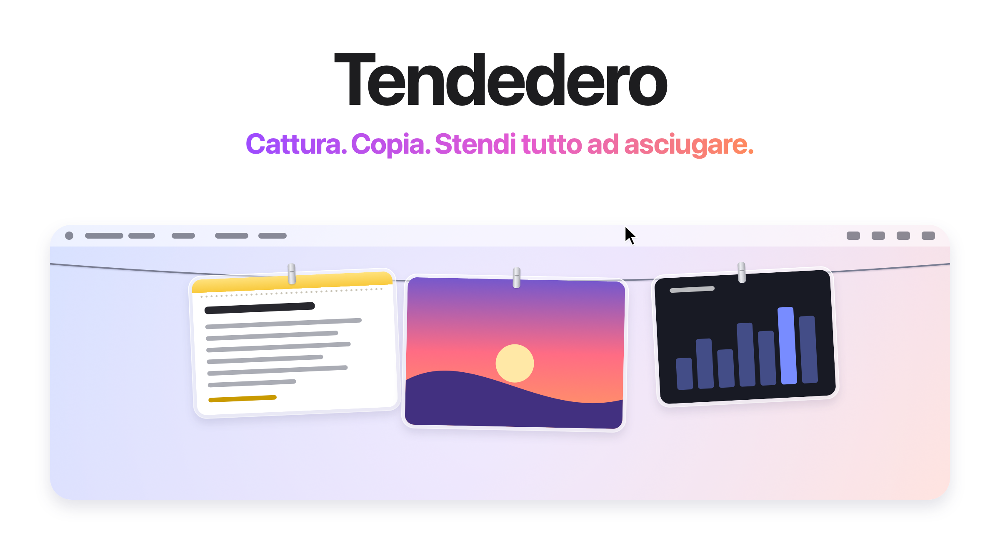

<picture>
  <source media="(prefers-color-scheme: dark)" srcset="../images/it/hero-dark.png">
  
</picture>

<h3 align="center"><a href="https://tendedero.app/">Provala nel browser su tendedero.app&nbsp;&rsaquo;</a></h3>

<p align="center">
  Gratuita e open source. Per macOS 14 e successivi.
  <br>
  <a href="../../../../releases/latest">Scarica&nbsp;&rsaquo;</a>
  &nbsp;&nbsp;
  <a href="#compila-dal-codice-sorgente">Compila dal codice sorgente&nbsp;&rsaquo;</a>
  <br><br>
  <a href="../../README.md">English</a>&nbsp;·&nbsp;<a href="README.es.md">Español</a>&nbsp;·&nbsp;<a href="README.gl.md">Galego</a>&nbsp;·&nbsp;<a href="README.fr.md">Français</a>&nbsp;·&nbsp;<a href="README.pt-BR.md">Português (Brasil)</a>&nbsp;·&nbsp;Italiano&nbsp;·&nbsp;<a href="README.ja.md">日本語</a>&nbsp;·&nbsp;<a href="README.ko.md">한국어</a>&nbsp;·&nbsp;<a href="README.zh-Hans.md">简体中文</a>&nbsp;·&nbsp;<a href="README.tr.md">Türkçe</a>&nbsp;·&nbsp;<a href="README.az.md">Azərbaycanca</a>&nbsp;·&nbsp;<a href="README.hi.md">हिन्दी</a>&nbsp;·&nbsp;<a href="README.vi.md">Tiếng Việt</a>
  <br>
  <sub>Traduzione del README in inglese. In caso di differenze, fa fede la versione inglese.</sub>
</p>

<p align="center">
  <a href="https://trendshift.io/repositories/287033?utm_source=trendshift-badge&amp;utm_medium=badge&amp;utm_campaign=badge-trendshift-287033" target="_blank" rel="noopener noreferrer"></a>
  <a href="https://trendshift.io/repositories/287033?utm_source=trendshift-badge&amp;utm_medium=badge&amp;utm_campaign=badge-trendshift-287033" target="_blank" rel="noopener noreferrer"></a>
</p>

<br>

## Fuori dalla vista. Sempre a portata di mano.

Ogni screenshot che fai, e tutto ciò che copi, resta appeso a un filo proprio sopra lo schermo.
Porta il puntatore al centro della barra dei menu e il filo scende. Allontanalo e sparisce.

<picture>
  <source media="(prefers-color-scheme: dark)" srcset="../images/it/demo-dark.gif">
  
</picture>

<br>
<br>

## Un gesto per ogni cosa.

<picture>
  <source media="(prefers-color-scheme: dark)" srcset="../images/it/bento-dark.png">
  
</picture>

<br>
<br>

| | |
|:--|:--|
| Clic | Copia la foto. Una nota copia il suo testo, con la sua formattazione. |
| Tenere premuto | La apre per annotarla. Una nota si apre per modificarla. |
| Doppio clic | La apre in Anteprima. Un link si apre nel browser. |
| Clic con pressione | Le dà un’occhiata con Visualizzazione rapida. |
| Trascinare in un’app | Invia una copia, e lo screenshot resta sul filo. |
| Trascinare in una cartella | Resta lì e lascia il filo. |
| Trascinare nel Cestino o fare clic sulla crocetta | Te ne liberi. |
| Clic con Maiusc | Ne seleziona più d’una. Il loro menu, <kbd>⌘</kbd>&thinsp;<kbd>C</kbd>, <kbd>⌫</kbd> e un trascinamento agiscono su tutte. <kbd>Esc</kbd> o un semplice clic annulla la selezione. |
| <kbd>⌘</kbd>&thinsp;<kbd>Z</kbd> con il puntatore sul filo | Annulla quello che hai appena fatto: togliere, fissare o salvare sulla Scrivania, anche un’intera selezione. |
| <kbd>Spazio</kbd> con il puntatore su una foto | Dalle un’occhiata. |
| <kbd>⌫</kbd> con il puntatore su una foto | Toglila, come con il pulsante nell’angolo. |
| Clic destro, poi Condividi | Inviala con AirDrop, Messaggi, Mail e altro, e lo screenshot resta sul filo. |
| Clic destro, poi Fissa | Tienila: resta appesa a sinistra del nodo con una molletta grigio siderale, e nessun nuovo screenshot la spinge via. |
| Clic destro, poi Tieni in mano | Toglila dal filo e tienila davanti a te mentre lavori. Una nota tenuta in mano è testo che puoi selezionare. |
| Nel Finder, clic destro su un’immagine o un file di testo, poi Appendi in Tendedero | Appendilo al filo, fissato. |
| Fermare il puntatore su una foto, con Ingrandisci al passaggio attivo | La vedi più grande al centro dello schermo. |
| Fermare il puntatore al centro della barra dei menu | Fa scendere il filo su quello schermo. |
| Fare clic in un punto qualsiasi della barra dei menu | Ritira il filo. |
| <kbd>⌃</kbd>&thinsp;<kbd>⌥</kbd>&thinsp;<kbd>T</kbd> | Mostra o nasconde il filo. Si cambia in Scorciatoia, nella barra dei menu. |
| <kbd>⌃</kbd>&thinsp;<kbd>⌥</kbd>&thinsp;<kbd>F</kbd> | Cerca sul filo. |

<br>

## La tua Scrivania, finalmente in ordine.

Lascia che Tendedero gestisca i tuoi screenshot<sup>1</sup> e non passeranno più
dalla Scrivania. Niente miniatura fluttuante, niente cinque secondi di attesa:
ogni screenshot si appende nel momento in cui lo fai, e resta solo quello
che porti via dal filo.

Anche le registrazioni dello schermo si appendono, con un pulsante play sopra.
Tienine premuta una per tagliarla.

Le stesse scorciatoie. Le stesse abitudini. Solo meno disordine.

<br>

## Anche testo, link e immagini che copi.

Attivali uno per uno in Appendi ciò che copi, nella barra dei menu; finché
almeno uno è attivo, la maglietta si riempie.

Il testo copiato si appende come una nota, un foglio di Note nella stessa
cornice di vetro: la prima riga è il titolo, il Markdown appare formattato e il
codice mantiene le sue righe. Un indirizzo web si appende come link, con il
sito e il percorso. Fai uno screenshot tenendo premuto <kbd>⌃</kbd>, o copia
un’immagine in Anteprima, e si appende come tutte le altre.

Non viene tenuto nulla da un campo password, da ciò che un gestore di password
segna come privato, o da un altro dispositivo tramite Appunti condivisi.

<br>

## Trova qualsiasi cosa sul filo.

Premi <kbd>⌃</kbd>&thinsp;<kbd>⌥</kbd>&thinsp;<kbd>F</kbd> e scrivi. Sul filo
resta solo ciò che corrisponde: le parole in uno screenshot, lette sul tuo Mac
nel momento in cui si appende, e le parole di ogni nota e link.
<kbd>Invio</kbd> copia la corrispondenza più recente.

<br>

## Privacy di serie.

Nessun account. Nessuna connessione. Nessuna analisi.
Tendedero funziona solo sul tuo Mac, lettura del testo negli screenshot compresa,
e nulla di ciò che appendi lo lascia mai.

<br>

## Specifiche tecniche

| | |
|:--|:--|
| **Compatibilità** | macOS 14 Sonoma o successivi, su Mac con Apple silicon o Intel. Pensata per macOS 27. |
| **Dimensioni** | 3,5 MB |
| **Lingue** | Inglese, spagnolo, galiziano, francese, portoghese (Brasile), italiano, giapponese, coreano, cinese semplificato, turco, azero, hindi e vietnamita |
| **Realizzata con** | Swift, AppKit e SwiftUI |
| **Accesso alla rete** | Nessuno |
| **Prezzo** | Gratuita |
| **Licenza** | MIT per il codice. Il nome e l’icona sono esclusi. |

<br>

## Installazione

Scarica l’immagine disco dall’[ultima versione](../../../../releases/latest),
aprila e trascina Tendedero in Applicazioni. Oppure installala con Homebrew:

```sh
brew install tendedero
```

Tendedero è firmata con un Developer ID e autenticata da Apple, quindi si
apre come qualsiasi altra app.

<br>

## Compila dal codice sorgente

```sh
git clone git@github.com:alejandrobujan/tendedero.git
cd tendedero
scripts/build-app.sh
open build/Tendedero.app
```

Servono solo gli strumenti di Swift; Xcode è facoltativo. Con i Command Line
Tools di macOS 27, lo script usa l’SDK di macOS 26 che viene installato con
loro, perché il nuovo SDK richiede un plugin di macro di SwiftUI incluso solo
in Xcode. Le build locali sono firmate ad hoc, quindi macOS chiede di nuovo
l’accesso alla Scrivania dopo ogni nuova compilazione.

Vuoi dare una mano? Leggi prima [CONTRIBUTING.md](../../CONTRIBUTING.md).

<details>
<summary>Dentro l’app</summary>
<br>

| File | Cosa fa |
|:--|:--|
| `AppDelegate.swift` | La barra dei menu, la scorciatoia, e far scendere e ritirare il filo |
| `LinePanel.swift` | La striscia trasparente lungo il bordo superiore dello schermo |
| `LineView.swift` | Il filo e dove si appende ogni foto |
| `PeggedView.swift` | Ogni foto o nota: cornice di vetro, molletta, oscillazione e brezza |
| `GrabArea.swift` | Clic, pressione prolungata, trascinamento e rilascio |
| `ScreenshotWatcher.swift` | Si accorge dei nuovi screenshot |
| `ClipboardWatcher.swift` | Si accorge di immagini, testo e link copiati negli appunti |
| `NoteSheet.swift` | Il testo copiato, disegnato come un foglio di Note |
| `Markdown.swift` | Il Markdown nelle note |
| `Inbox.swift` | Prende il controllo delle impostazioni degli screenshot e poi le restituisce |
| `Markup.swift` | Apre l’editor di annotazioni del sistema e salva il risultato |
| `Trim.swift` | Taglia una registrazione dello schermo e salva il risultato |
| `FullScreen.swift` | Sa quando deve restare nascosto |
| `Line.swift` | Cosa è appeso, e cosa puoi farci |
| `Held.swift` | Una foto tenuta in mano davanti a te, fuori dal filo |
| `SearchIndex.swift` | Legge il testo negli screenshot, su questo Mac, per la ricerca |
| `SearchBar.swift` | Il campo di ricerca sotto il filo |
| `Zoom.swift` | Una copia più grande di una foto al passaggio del puntatore |
| `Share.swift` | Condividi, dal menu di una foto |

Tutte le immagini di questa pagina, icona compresa, sono disegnate in codice da
`scripts/make-icon.swift` e `scripts/make-readme-art.swift`.
`scripts/make-dmg.sh` crea l’immagine disco di ogni versione.

Le traduzioni si trovano in `Sources/Tendedero/Resources`, con una cartella
`.lproj` per lingua. `swift scripts/check-strings.swift` avvisa se ne manca qualcuna.

</details>

<br>

---

<sub>
1. Al primo avvio, Tendedero si offre di gestire i tuoi screenshot. Se accetti, disattiva la miniatura fluttuante e salva i nuovi screenshot in una cartella tutta sua: due impostazioni che trovi anche in Opzioni di Cmd+Maiusc+5. Le impostazioni precedenti vengono salvate e ripristinate quando esci da Tendedero o disattivi l’opzione dalla barra dei menu. Mentre un’app è a tutto schermo, Tendedero si nasconde da sola.
</sub>

<br>
<br>

<p align="center">
  
  <br>
  <sub>Il codice ha licenza MIT, ma il nome e l’icona di Tendedero no, quindi ogni fork ha bisogno dei propri. Maggiori dettagli in <a href="../../LICENSE">LICENSE</a>.</sub>
  <br>
  <sub>Progettata e sviluppata da <a href="https://alejandrobujan.com">Alejandro Buján</a>.</sub>
</p>
