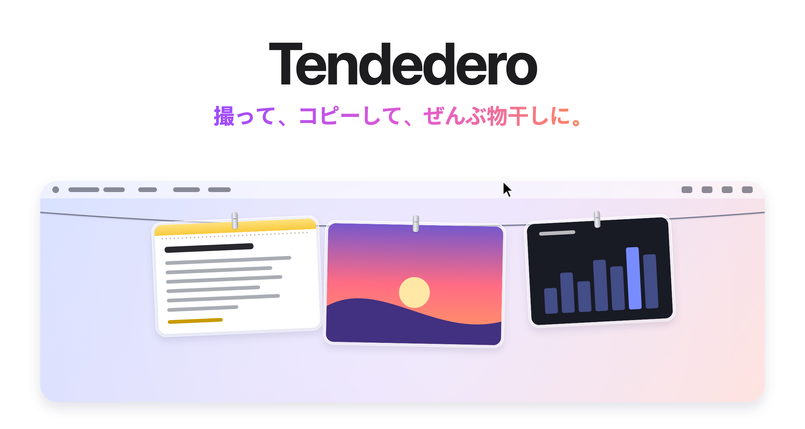
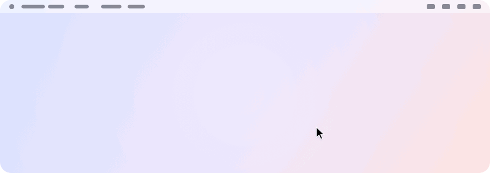
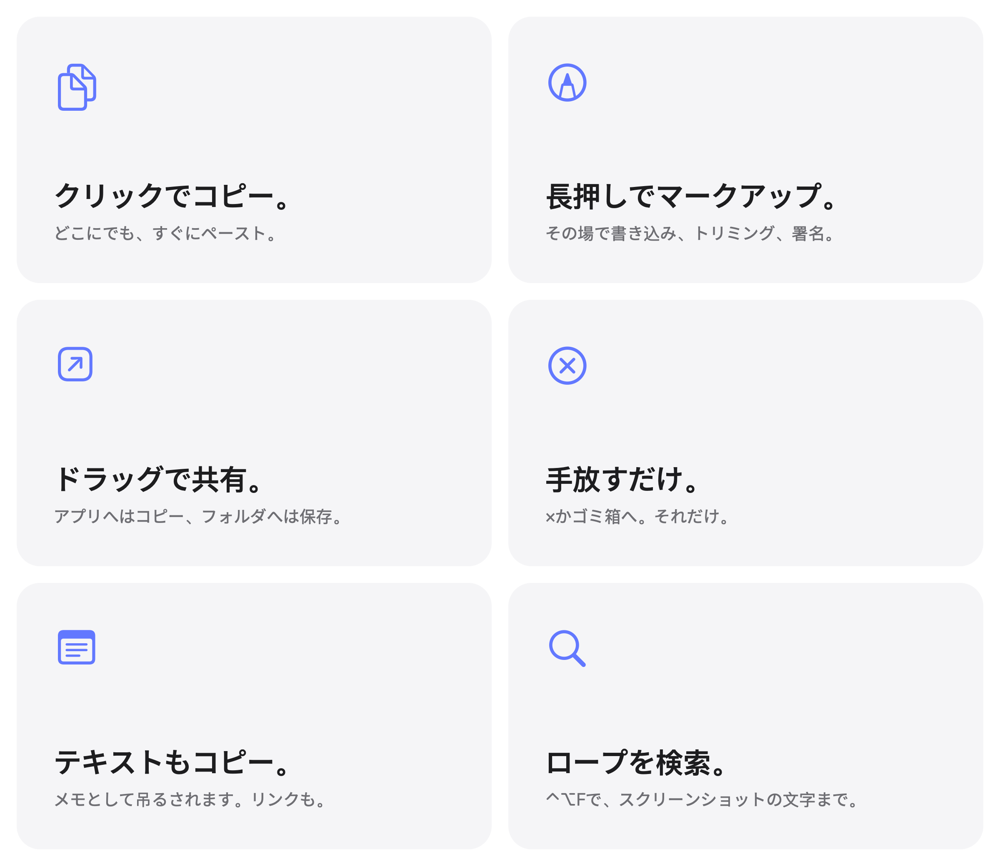

<picture>
  <source media="(prefers-color-scheme: dark)" srcset="../images/ja/hero-dark.png">
  
</picture>

<h3 align="center"><a href="https://tendedero.app/?lang=ja">tendedero.appでブラウザから試す&nbsp;&rsaquo;</a></h3>

<p align="center">
  無料のオープンソース。macOS 14以降に対応。
  <br>
  <a href="../../../../releases/latest">ダウンロード&nbsp;&rsaquo;</a>
  &nbsp;&nbsp;
  <a href="#ソースからビルド">ソースからビルド&nbsp;&rsaquo;</a>
  <br><br>
  <a href="../../README.md">English</a>&nbsp;·&nbsp;<a href="README.es.md">Español</a>&nbsp;·&nbsp;<a href="README.gl.md">Galego</a>&nbsp;·&nbsp;<a href="README.fr.md">Français</a>&nbsp;·&nbsp;<a href="README.pt-BR.md">Português (Brasil)</a>&nbsp;·&nbsp;<a href="README.it.md">Italiano</a>&nbsp;·&nbsp;日本語&nbsp;·&nbsp;<a href="README.ko.md">한국어</a>&nbsp;·&nbsp;<a href="README.zh-Hans.md">简体中文</a>&nbsp;·&nbsp;<a href="README.tr.md">Türkçe</a>&nbsp;·&nbsp;<a href="README.az.md">Azərbaycanca</a>&nbsp;·&nbsp;<a href="README.hi.md">हिन्दी</a>&nbsp;·&nbsp;<a href="README.vi.md">Tiếng Việt</a>
  <br>
  <sub>このページは英語版READMEの翻訳です。内容に相違がある場合は英語版が優先されます。</sub>
</p>

<p align="center">
  <a href="https://trendshift.io/repositories/287033?utm_source=trendshift-badge&amp;utm_medium=badge&amp;utm_campaign=badge-trendshift-287033" target="_blank" rel="noopener noreferrer"></a>
  <a href="https://trendshift.io/repositories/287033?utm_source=trendshift-badge&amp;utm_medium=badge&amp;utm_campaign=badge-trendshift-287033" target="_blank" rel="noopener noreferrer"></a>
</p>

<br>

## 目には入らず、手は届く。

撮ったスクリーンショットも、コピーしたものも、すべて画面のすぐ上のロープに吊るされます。
メニューバーの中央にポインタを置くと、するりと降りてきます。離れると消えます。

<picture>
  <source media="(prefers-color-scheme: dark)" srcset="../images/ja/demo-dark.gif">
  
</picture>

<br>
<br>

## どんな操作も、ジェスチャひとつで。

<picture>
  <source media="(prefers-color-scheme: dark)" srcset="../images/ja/bento-dark.png">
  
</picture>

<br>
<br>

| | |
|:--|:--|
| クリック | コピー。メモは書式ごとテキストをコピーします。 |
| 長押し | 「マークアップ」で開く。メモは編集できる状態で開きます。 |
| ダブルクリック | 「プレビュー」で開く。リンクはブラウザで開きます。 |
| 強めのクリック | クイックルックでさっと確認。 |
| アプリにドラッグ | コピーを送る。ロープには残ります。 |
| フォルダにドラッグ | そこに保存。ロープからは外れます。 |
| ゴミ箱にドラッグ、または×をクリック | 手放す。 |
| Shiftキーを押しながらクリック | 複数を選択。メニュー、<kbd>⌘</kbd>&thinsp;<kbd>C</kbd>、<kbd>⌫</kbd>、ドラッグがすべてに働きます。<kbd>Esc</kbd>か普通のクリックで選択を解除します。 |
| ポインタをロープ上に置いて <kbd>⌘</kbd>&thinsp;<kbd>Z</kbd> | 直前の操作を取り消す。手放す、ピン留め、デスクトップに保存のどれでも、選択した分もまとめて戻せます。 |
| ポインタを写真に置いて <kbd>Space</kbd> | クイックルックで見る。 |
| ポインタを写真に置いて <kbd>⌫</kbd> | 角のボタンと同じように手放す。 |
| 右クリックして「共有」 | AirDrop、メッセージ、メールなどで送る。ロープには残ります。 |
| 右クリックして「ピン留め」 | 残しておく。結び目の左にスペースグレイのクリップで吊るされ、新しいスクリーンショットに押し出されない。 |
| 右クリックして「手に取る」 | ロープから外して、作業中も目の前に置いておく。手に取ったメモは、テキストを選択できます。 |
| Finderで画像かテキストファイルを右クリックして「Tendederoに吊るす」 | ピン留めしてロープに吊るす。 |
| 「ポインタを重ねて拡大」をオンにして、写真にポインタを置く | 画面の中央に大きく表示。 |
| メニューバーの中央にポインタを置く | その画面にロープを降ろす。 |
| メニューバーのどこかをクリック | ロープをしまう。 |
| <kbd>⌃</kbd>&thinsp;<kbd>⌥</kbd>&thinsp;<kbd>T</kbd> | ロープを表示または非表示。メニューバーの「ショートカット」で変更できます。 |
| <kbd>⌃</kbd>&thinsp;<kbd>⌥</kbd>&thinsp;<kbd>F</kbd> | ロープを検索。 |

<br>

## デスクトップが、やっとすっきり。

スクリーンショットをTendederoに任せれば<sup>1</sup>、デスクトップを一切経由しません。
フローティングサムネールも、5秒の待ち時間もなし。撮った瞬間にロープに吊るされ、残るのはドラッグして取り出したものだけです。

画面収録もロープに吊るされ、再生ボタンが付きます。
長押しすればトリミングできます。

ショートカットはそのまま。手が覚えた操作もそのまま。散らからなくなるだけです。

<br>

## コピーしたテキスト、リンク、画像も。

メニューバーの「コピーしたものを吊るす」でひとつずつオンにでき、どれかがオンの間はシャツのアイコンが塗りつぶされます。

コピーしたテキストはメモとして吊るされます。同じガラスのフレームに入った「メモ」の1枚のように、最初の行がタイトルになり、Markdownは書式付きで表示され、コードは改行がそのまま保たれます。
Webアドレスはサイトとパスがわかるリンクとして吊るされます。<kbd>⌃</kbd>を押しながらスクリーンショットを撮るか、「プレビュー」で画像をコピーすると、ほかと同じように吊るされます。

パスワード欄の内容、パスワードマネージャが非公開に指定したもの、ユニバーサルクリップボードでほかのデバイスから届いたものは、何も残しません。

<br>

## ロープの上から、なんでも見つかる。

<kbd>⌃</kbd>&thinsp;<kbd>⌥</kbd>&thinsp;<kbd>F</kbd>を押して入力するだけ。ロープに残るのは一致したものだけです。対象は、吊るした瞬間にMac上で読み取ったスクリーンショット内の文字と、すべてのメモとリンクの文字です。
<kbd>Return</kbd>で最新の一致をコピーします。

<br>

## 最初からプライベート。

アカウント不要。ネットワーク接続なし。解析なし。
Tendederoはスクリーンショット内の文字の読み取りも含めて完全にMac上で動作し、吊るしたものがMacの外に出ることはありません。

<br>

## 技術仕様

| | |
|:--|:--|
| **互換性** | macOS 14 Sonoma以降、Appleシリコン搭載MacとIntel搭載Macに対応。macOS 27向けにデザイン。 |
| **サイズ** | 5.1MB |
| **言語** | 英語、スペイン語、ガリシア語、フランス語、ポルトガル語（ブラジル）、イタリア語、日本語、韓国語、中国語（簡体字）、トルコ語、アゼルバイジャン語、ヒンディー語、ベトナム語 |
| **開発環境** | Swift、AppKit、SwiftUI |
| **ネットワークアクセス** | なし |
| **価格** | 無料 |
| **ライセンス** | コードはMIT。名前とアイコンは含まれません。 |

<br>

## インストール

[最新リリース](../../../../releases/latest)からディスクイメージをダウンロードして開き、Tendederoを「アプリケーション」フォルダにドラッグします。Homebrewでもインストールできます：

```sh
brew install tendedero
```

TendederoはDeveloper IDで署名され、Appleによる公証を受けているため、ほかのアプリと同じように開けます。

<br>

## ソースからビルド

```sh
git clone git@github.com:alejandrobujan/tendedero.git
cd tendedero
scripts/build-app.sh
open build/Tendedero.app
```

Swiftツールチェーンが必要です。Xcodeは任意です。macOS 27のCommand Line Toolsを使う場合、新しいSDKにはXcodeにしか含まれないSwiftUIのマクロプラグインが必要なため、スクリプトは一緒にインストールされるmacOS 26 SDKに切り替えます。ローカルビルドはアドホック署名のため、再ビルドのたびにmacOSがデスクトップへのアクセスを改めて確認します。

<details>
<summary>アプリの中身</summary>
<br>

| ファイル | 役割 |
|:--|:--|
| `AppDelegate.swift` | メニューバー、ショートカット、ロープを降ろす・しまう動き |
| `LinePanel.swift` | 画面上端に沿った透明な帯 |
| `LineView.swift` | ロープと、各写真を吊るす位置 |
| `PeggedView.swift` | 写真またはメモ1枚：ガラスのフレーム、洗濯バサミ、揺れとそよ風 |
| `GrabArea.swift` | クリック、長押し、ドラッグ＆ドロップ |
| `ScreenshotWatcher.swift` | 新しいスクリーンショットを検知 |
| `ClipboardWatcher.swift` | クリップボードにコピーされた画像、テキスト、リンクを検知 |
| `NoteSheet.swift` | コピーしたテキストを「メモ」の1枚として描画 |
| `Markdown.swift` | メモの中のMarkdown |
| `Inbox.swift` | スクリーンショットの設定を引き継ぎ、元に戻す |
| `Markup.swift` | システムのマークアップエディタを開き、結果を保存 |
| `Trim.swift` | 画面収録をトリミングし、結果を保存 |
| `FullScreen.swift` | 隠れているべきときを判断 |
| `Line.swift` | 吊るされているものと、それに対してできること |
| `Held.swift` | ロープから外して目の前に置いた写真 |
| `SearchIndex.swift` | 検索のため、スクリーンショット内の文字をこのMac上で読み取る |
| `SearchBar.swift` | ロープの下の検索フィールド |
| `Zoom.swift` | ポインタを重ねたときの写真の拡大表示 |
| `Share.swift` | 写真のメニューからの共有 |

このページの画像は、アイコンも含めすべて`scripts/make-icon.swift`と`scripts/make-readme-art.swift`がコードで描いています。
`scripts/make-dmg.sh`はリリース用のディスクイメージを作成します。

翻訳は`Sources/Tendedero/Resources`にあり、言語ごとに`.lproj`フォルダが1つずつあります。
`swift scripts/check-strings.swift`で抜けがないか確認できます。

</details>

<br>

---

<sub>
1. 初回起動時、Tendederoはスクリーンショットを任せるかどうかを尋ねます。承諾すると、フローティングサムネールをオフにし、新しいスクリーンショットを専用のフォルダに保存します。この2つの設定はCmd+Shift+5の「オプション」にもあります。それまでの設定は保存され、Tendederoを終了したとき、またはメニューバーからこのオプションをオフにしたときに元に戻ります。アプリがフルスクリーン表示の間、Tendederoは自動的に隠れます。
</sub>

<br>
<br>

<p align="center">
  
  <br>
  <sub>コードはMITライセンスです。Tendederoの名前とアイコンは対象外のため、フォークには独自の名前とアイコンが必要です。<a href="../../LICENSE">LICENSE</a>をご覧ください。</sub>
  <br>
  <sub>デザインと開発：<a href="https://alejandrobujan.com">Alejandro Buján</a></sub>
</p>
