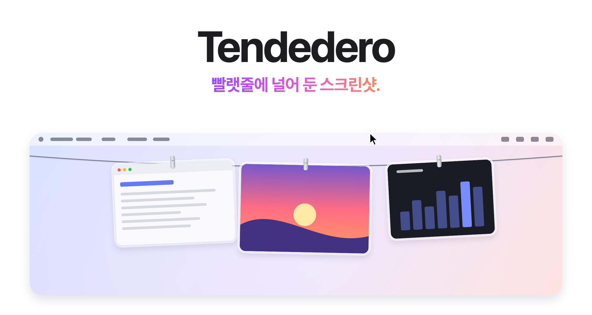

<picture>
  <source media="(prefers-color-scheme: dark)" srcset="../images/ko/hero-dark.png">
  
</picture>

<h3 align="center"><a href="https://tendedero.app/?lang=ko">tendedero.app에서 브라우저로 바로 사용해 보세요&nbsp;&rsaquo;</a></h3>

<p align="center">
  무료 오픈 소스. macOS 14 이상용.
  <br>
  <a href="../../../../releases/latest">다운로드&nbsp;&rsaquo;</a>
  &nbsp;&nbsp;
  <a href="#소스에서-빌드하기">소스에서 빌드하기&nbsp;&rsaquo;</a>
  <br><br>
  <a href="../../README.md">English</a>&nbsp;·&nbsp;<a href="README.es.md">Español</a>&nbsp;·&nbsp;<a href="README.gl.md">Galego</a>&nbsp;·&nbsp;<a href="README.fr.md">Français</a>&nbsp;·&nbsp;<a href="README.pt-BR.md">Português (Brasil)</a>&nbsp;·&nbsp;<a href="README.ja.md">日本語</a>&nbsp;·&nbsp;한국어&nbsp;·&nbsp;<a href="README.zh-Hans.md">简体中文</a>&nbsp;·&nbsp;<a href="README.tr.md">Türkçe</a>&nbsp;·&nbsp;<a href="README.az.md">Azərbaycanca</a>&nbsp;·&nbsp;<a href="README.hi.md">हिन्दी</a>
  <br>
  <sub>영어 README를 번역한 문서예요. 내용이 다를 경우 영어 원문이 우선해요.</sub>
</p>

<p align="center">
  <a href="https://trendshift.io/repositories/287033?utm_source=trendshift-badge&amp;utm_medium=badge&amp;utm_campaign=badge-trendshift-287033" target="_blank" rel="noopener noreferrer"></a>
  <a href="https://trendshift.io/repositories/287033?utm_source=trendshift-badge&amp;utm_medium=badge&amp;utm_campaign=badge-trendshift-287033" target="_blank" rel="noopener noreferrer"></a>
</p>

<br>

## 눈에는 안 보이게. 손에는 닿게.

찍는 모든 스크린샷이 화면 바로 위의 빨랫줄에 걸려요.
포인터를 메뉴 막대에 올려 두면 줄이 스르륵 내려오고, 포인터를 떼면 사라져요.

<picture>
  <source media="(prefers-color-scheme: dark)" srcset="../images/ko/demo-dark.gif">
  
</picture>

<br>
<br>

## 무엇이든 제스처 하나로.

<picture>
  <source media="(prefers-color-scheme: dark)" srcset="../images/ko/bento-dark.png">
  
</picture>

<br>
<br>

| | |
|:--|:--|
| 클릭 | 이미지를 복사해요. |
| 길게 누르기 | 마크업에서 열어요. |
| 이중 클릭 | 미리보기에서 열어요. |
| 강한 클릭 | 훑어보기로 살펴봐요. |
| 앱으로 드래그 | 사본을 보내요. 빨랫줄에는 그대로 남아요. |
| 폴더로 드래그 | 폴더에 보관해요. 빨랫줄에서는 사라져요. |
| 휴지통으로 드래그하거나 X 버튼 클릭 | 미련 없이 버려요. |
| 포인터를 메뉴 막대에 올려 두기 | 그 화면에 빨랫줄을 내려요. |
| 메뉴 막대의 아무 곳이나 클릭 | 빨랫줄을 치워요. |
| <kbd>⌃</kbd>&thinsp;<kbd>⌥</kbd>&thinsp;<kbd>T</kbd> | 빨랫줄을 보거나 가려요. 메뉴 막대의 단축키에서 바꿀 수 있어요. |

<br>

## 마침내 깔끔해진 데스크탑.

스크린샷을 Tendedero에 맡기면<sup>1</sup> 데스크탑을 전혀 거치지 않아요.
플로팅 썸네일도, 5초의 기다림도 없어요. 찍는 순간 바로 빨랫줄에 걸리고,
직접 드래그해서 꺼낸 것만 남아요.

화면 기록도 재생 버튼이 붙은 채로 빨랫줄에 걸려요.
길게 누르면 다듬을 수 있어요.

단축키도 그대로, 손에 익은 동작도 그대로. 어수선함만 줄었어요.

<br>

## 복사한 이미지도.

<kbd>⌃</kbd> 키를 누른 채 스크린샷을 찍거나 미리보기에서 이미지를 복사하면,
다른 스크린샷처럼 빨랫줄에 걸려요. 메뉴 막대에서 복사한 이미지 걸기를 켜면
켜져 있는 동안 셔츠 아이콘이 채워져요. 이미지만 걸려요. 텍스트나 파일과 함께
복사한 것, 그리고 암호 관리자가 비공개로 표시한 것은 건드리지 않아요.

<br>

## 설계 단계부터 개인정보 보호.

계정도, 네트워크도, 분석도 없어요.
Tendedero는 전적으로 Mac에서만 실행되며, 스크린샷은 절대 Mac 밖으로 나가지 않아요.

<br>

## 기술 사양

| | |
|:--|:--|
| **호환성** | Apple 실리콘 및 Intel 기반 Mac의 macOS 14 Sonoma 이상. macOS 27에 맞춰 디자인됨. |
| **크기** | 1.7MB |
| **언어** | 영어, 스페인어, 갈리시아어, 프랑스어, 포르투갈어(브라질), 일본어, 한국어, 중국어(간체), 튀르키예어, 아제르바이잔어, 힌디어 |
| **개발 도구** | Swift, AppKit 및 SwiftUI |
| **네트워크 접근** | 없음 |
| **가격** | 무료 |
| **라이선스** | 코드는 MIT. 이름과 아이콘은 포함되지 않아요. |

<br>

## 설치

[최신 릴리스](../../../../releases/latest)에서 디스크 이미지를 다운로드해 열고,
Tendedero를 응용 프로그램 폴더로 드래그하세요. Homebrew로 설치할 수도 있어요.

```sh
brew install --cask alejandrobujan/tap/tendedero
```

Tendedero는 Developer ID로 서명되고 Apple의 공증을 받았기 때문에
다른 앱과 똑같이 열려요.

<br>

## 소스에서 빌드하기

```sh
git clone git@github.com:alejandrobujan/tendedero.git
cd tendedero
scripts/build-app.sh
open build/Tendedero.app
```

Swift 툴체인이 필요하며, Xcode는 없어도 돼요. macOS 27용 Command Line Tools를
사용하는 경우, 스크립트는 함께 설치되는 macOS 26 SDK로 대신 빌드해요. 새 SDK에는
Xcode에만 포함된 SwiftUI 매크로 플러그인이 필요하기 때문이에요. 로컬 빌드는 ad hoc
서명되므로, 다시 빌드할 때마다 macOS가 데스크탑 접근 권한을 다시 물어봐요.

<details>
<summary>앱 내부 구조</summary>
<br>

| 파일 | 역할 |
|:--|:--|
| `AppDelegate.swift` | 메뉴 막대, 단축키, 빨랫줄을 내리고 치우는 동작 |
| `LinePanel.swift` | 화면 맨 위를 따라 놓인 투명한 띠 |
| `LineView.swift` | 빨랫줄과 각 사진이 걸리는 위치 |
| `PeggedView.swift` | 사진 한 장: 유리 액자, 집게, 흔들림과 산들바람 |
| `GrabArea.swift` | 클릭, 길게 누르기, 드래그 앤 드롭 |
| `ScreenshotWatcher.swift` | 새 스크린샷 감지 |
| `ClipboardWatcher.swift` | 클립보드에 복사된 이미지 감지 |
| `Inbox.swift` | 스크린샷 설정을 넘겨받았다가 원래대로 되돌림 |
| `Markup.swift` | 시스템 마크업 편집기를 열고 결과를 저장 |
| `Trim.swift` | 화면 기록을 다듬고 결과를 저장 |
| `FullScreen.swift` | 숨어 있어야 할 때를 판단 |
| `Line.swift` | 무엇이 걸려 있는지, 그리고 그걸로 무엇을 할 수 있는지 |

아이콘을 포함해 이 문서의 모든 이미지는 `scripts/make-icon.swift`와
`scripts/make-readme-art.swift`가 코드로 그려요.
`scripts/make-dmg.sh`는 릴리스용 디스크 이미지를 만들어요.

번역은 `Sources/Tendedero/Resources`에 언어별 `.lproj` 폴더로 들어 있어요.
`swift scripts/check-strings.swift`로 빠진 번역이 없는지 확인할 수 있어요.

</details>

<br>

---

<sub>
1. 처음 실행하면 Tendedero가 스크린샷을 관리할지 물어봐요. 수락하면 플로팅 썸네일을 끄고 새 스크린샷을 자체 폴더에 저장해요. 두 설정 모두 Cmd+Shift+5의 옵션에서도 찾을 수 있어요. 이전 설정은 저장해 두었다가 Tendedero를 종료하거나 메뉴 막대에서 이 옵션을 끄면 복원돼요. 앱이 전체 화면일 때는 Tendedero가 자동으로 숨겨져요.
</sub>

<br>
<br>

<p align="center">
  
  <br>
  <sub>코드는 MIT 라이선스예요. Tendedero의 이름과 아이콘은 그렇지 않으므로, 포크하려면 자체 이름과 아이콘이 필요해요. <a href="../../LICENSE">LICENSE</a>를 참고하세요.</sub>
  <br>
  <sub><a href="https://alejandrobujan.com">Alejandro Buján</a>이 디자인하고 개발했어요.</sub>
</p>
