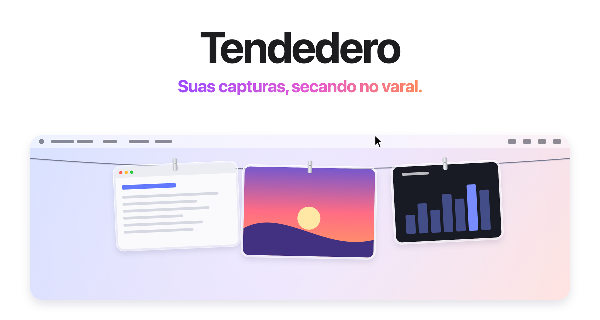

<picture>
  <source media="(prefers-color-scheme: dark)" srcset="../images/pt-BR/hero-dark.png">
  
</picture>

<h3 align="center"><a href="https://tendedero.app/?lang=pt-BR">Experimente no navegador em tendedero.app&nbsp;&rsaquo;</a></h3>

<p align="center">
  Gratuito e de código aberto. Para macOS 14 ou posterior.
  <br>
  <a href="../../../../releases/latest">Baixar&nbsp;&rsaquo;</a>
  &nbsp;&nbsp;
  <a href="#compilar-a-partir-do-código-fonte">Compilar a partir do código-fonte&nbsp;&rsaquo;</a>
  <br><br>
  <a href="../../README.md">English</a>&nbsp;·&nbsp;<a href="README.es.md">Español</a>&nbsp;·&nbsp;<a href="README.gl.md">Galego</a>&nbsp;·&nbsp;<a href="README.fr.md">Français</a>&nbsp;·&nbsp;Português (Brasil)&nbsp;·&nbsp;<a href="README.ja.md">日本語</a>&nbsp;·&nbsp;<a href="README.ko.md">한국어</a>&nbsp;·&nbsp;<a href="README.zh-Hans.md">简体中文</a>&nbsp;·&nbsp;<a href="README.tr.md">Türkçe</a>&nbsp;·&nbsp;<a href="README.az.md">Azərbaycanca</a>&nbsp;·&nbsp;<a href="README.hi.md">हिन्दी</a>
  <br>
  <sub>Tradução do README em inglês. Em caso de divergência, vale a versão em inglês.</sub>
</p>

<p align="center">
  <a href="https://trendshift.io/repositories/287033?utm_source=trendshift-badge&amp;utm_medium=badge&amp;utm_campaign=badge-trendshift-287033" target="_blank" rel="noopener noreferrer"></a>
  <a href="https://trendshift.io/repositories/287033?utm_source=trendshift-badge&amp;utm_medium=badge&amp;utm_campaign=badge-trendshift-287033" target="_blank" rel="noopener noreferrer"></a>
</p>

<br>

## Longe da vista. Ao alcance da mão.

Cada captura de tela que você faz fica pendurada num varal logo acima da tela.
Pare o ponteiro na barra de menus e o varal desce. Afaste-o e ele some.

<picture>
  <source media="(prefers-color-scheme: dark)" srcset="../images/pt-BR/demo-dark.gif">
  
</picture>

<br>
<br>

## Um gesto para cada coisa.

<picture>
  <source media="(prefers-color-scheme: dark)" srcset="../images/pt-BR/bento-dark.png">
  
</picture>

<br>
<br>

| | |
|:--|:--|
| Clicar | Copia a imagem. |
| Clicar e segurar | Abre na Marcação. |
| Clicar duas vezes | Abre no Pré-Visualização. |
| Clique forte | Abre na Visualização Rápida. |
| Arrastar para um app | Envia uma cópia. Ela continua no varal. |
| Arrastar para uma pasta | Guarda a imagem ali. Ela sai do varal. |
| Arrastar para o Lixo, ou clicar no X | Desapegue. |
| Parar o ponteiro na barra de menus | Baixa o varal naquela tela. |
| Clicar em qualquer lugar da barra de menus | Recolhe o varal. |
| <kbd>⌃</kbd>&thinsp;<kbd>⌥</kbd>&thinsp;<kbd>T</kbd> | Mostra ou oculta o varal. Altere em Atalho, na barra de menus. |

<br>

## Sua Mesa. Finalmente limpa.

Deixe o Tendedero cuidar das suas capturas<sup>1</sup> e elas nem passam pela
Mesa. Sem miniatura flutuante. Sem esperar cinco segundos. Cada captura vai
para o varal no instante em que você a faz, e só fica o que você arrastar para fora.

As gravações de tela também vão para o varal, com um botão de reprodução por cima.
Clique e segure numa delas para cortá-la.

Os mesmos atalhos. A mesma memória muscular. Só menos bagunça.

<br>

## Imagens copiadas também.

Faça uma captura segurando <kbd>⌃</kbd>, ou copie uma imagem no Pré-Visualização,
e ela vai para o varal como qualquer outra. Ative Pendurar imagens copiadas na
barra de menus; a camiseta fica preenchida enquanto a opção estiver ativa. Só
imagens: o que for copiado junto com texto ou um arquivo, e o que um gerenciador
de senhas marcar como privado, fica de fora.

<br>

## Privado por princípio.

Sem conta. Sem rede. Sem estatísticas.
O Tendedero roda inteiramente no seu Mac, e suas capturas nunca saem dele.

<br>

## Especificações técnicas

| | |
|:--|:--|
| **Compatibilidade** | macOS 14 Sonoma ou posterior, em Macs com Apple silicon e Intel. Projetado para o macOS 27. |
| **Tamanho** | 1,7 MB |
| **Idiomas** | Inglês, espanhol, galego, francês, português (Brasil), japonês, coreano, chinês simplificado, turco, azerbaijano e híndi |
| **Feito com** | Swift, AppKit e SwiftUI |
| **Acesso à rede** | Nenhum |
| **Preço** | Gratuito |
| **Licença** | MIT para o código. O nome e o ícone não estão incluídos. |

<br>

## Instalação

Baixe a imagem de disco da [versão mais recente](../../../../releases/latest),
abra-a e arraste o Tendedero para Aplicativos. Ou instale com o Homebrew:

```sh
brew install --cask alejandrobujan/tap/tendedero
```

O Tendedero é assinado com um Developer ID e notarizado pela Apple, então abre
como qualquer outro app.

<br>

## Compilar a partir do código-fonte

```sh
git clone git@github.com:alejandrobujan/tendedero.git
cd tendedero
scripts/build-app.sh
open build/Tendedero.app
```

Basta ter as ferramentas do Swift; o Xcode é opcional. Com as Command Line Tools
do macOS 27, o script recorre ao SDK do macOS 26 que elas instalam junto, porque
o novo SDK precisa de um plug-in de macros do SwiftUI que só vem com o Xcode. As
compilações locais são assinadas ad hoc, então o macOS volta a pedir acesso à
Mesa a cada nova compilação.

<details>
<summary>Por dentro do app</summary>
<br>

| Arquivo | Função |
|:--|:--|
| `AppDelegate.swift` | Barra de menus, atalho, baixar e recolher o varal |
| `LinePanel.swift` | A faixa transparente ao longo do topo da tela |
| `LineView.swift` | O varal e onde cada foto fica pendurada |
| `PeggedView.swift` | Uma foto: moldura de vidro, prendedor, balanço e brisa |
| `GrabArea.swift` | Clique, clique longo, arrastar e soltar |
| `ScreenshotWatcher.swift` | Percebe novas capturas |
| `ClipboardWatcher.swift` | Percebe imagens copiadas para a área de transferência |
| `Inbox.swift` | Assume os ajustes de captura e depois os restaura |
| `Markup.swift` | Abre o editor de Marcação do sistema e salva o resultado |
| `Trim.swift` | Corta uma gravação de tela e salva o resultado |
| `FullScreen.swift` | Sabe quando ficar escondido |
| `Line.swift` | O que está pendurado, e o que você pode fazer com isso |

Todas as imagens desta página, incluindo o ícone, são desenhadas em código por
`scripts/make-icon.swift` e `scripts/make-readme-art.swift`.
`scripts/make-dmg.sh` cria a imagem de disco de cada versão.

As traduções ficam em `Sources/Tendedero/Resources`, uma pasta `.lproj` por
idioma. `swift scripts/check-strings.swift` verifica se não falta nenhuma.

</details>

<br>

---

<sub>
1. Na primeira vez que é aberto, o Tendedero se oferece para cuidar das suas capturas de tela. Se você aceitar, ele desativa a miniatura flutuante e salva as novas capturas na sua própria pasta, dois ajustes que também ficam em Opções no Cmd+Shift+5. Seus ajustes anteriores são guardados e restaurados quando o Tendedero é encerrado ou quando a opção é desativada na barra de menus. O Tendedero se oculta automaticamente quando um app está em tela cheia.
</sub>

<br>
<br>

<p align="center">
  
  <br>
  <sub>O código tem licença MIT. O nome e o ícone do Tendedero não, então cada fork precisa dos seus. Veja a <a href="../../LICENSE">LICENSE</a>.</sub>
  <br>
  <sub>Projetado e desenvolvido por <a href="https://alejandrobujan.com">Alejandro Buján</a>.</sub>
</p>
