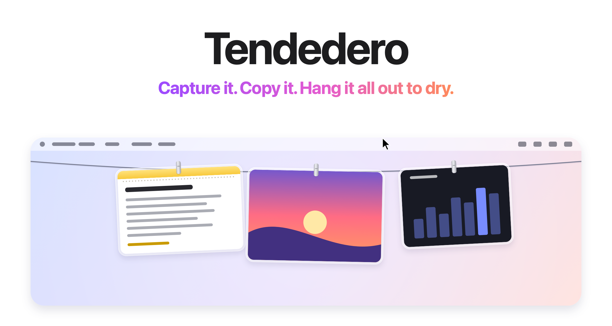
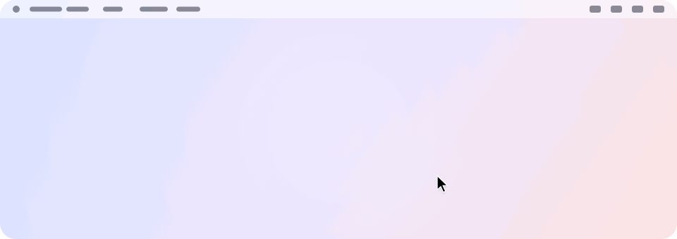
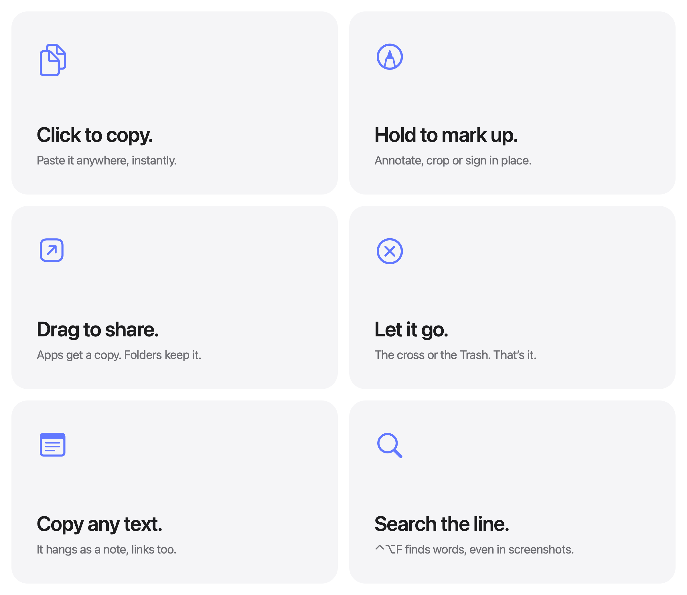
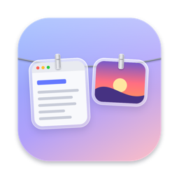

<picture>
  <source media="(prefers-color-scheme: dark)" srcset="../images/hero-dark.png">
  
</picture>

<h3 align="center"><a href="https://tendedero.app/?lang=ru">Попробуй в своём браузере на tendedero.app&nbsp;&rsaquo;</a></h3>

<p align="center">
  Бесплатно и с открытым кодом. Для macOS 14 и выше.
  <br>
  <a href="../../../../releases/latest">Загрузить&nbsp;&rsaquo;</a>
  &nbsp;&nbsp;
  <a href="#сборка-из-исходников">Собрать из исходников&nbsp;&rsaquo;</a>
  <br><br>
  <a href="../../README.md">English</a>&nbsp;·&nbsp;<a href="README.es.md">Español</a>&nbsp;·&nbsp;<a href="README.gl.md">Galego</a>&nbsp;·&nbsp;<a href="README.fr.md">Français</a>&nbsp;·&nbsp;<a href="README.pt-BR.md">Português (Brasil)</a>&nbsp;·&nbsp;<a href="README.it.md">Italiano</a>&nbsp;·&nbsp;<a href="README.ja.md">日本語</a>&nbsp;·&nbsp;<a href="README.ko.md">한국어</a>&nbsp;·&nbsp;<a href="README.zh-Hans.md">简体中文</a>&nbsp;·&nbsp;<a href="README.tr.md">Türkçe</a>&nbsp;·&nbsp;<a href="README.az.md">Azərbaycanca</a>&nbsp;·&nbsp;<a href="README.hi.md">हिन्दी</a>&nbsp;·&nbsp;<a href="README.vi.md">Tiếng Việt</a>&nbsp;·&nbsp;Русский<!-- &nbsp;·&nbsp;<a href="README.ru.md">Русский</a> <= ДОБАВИТЬ ВО ВСЕ ПЕРЕВОДЫ !!! -->
  <br>
  <sub>Это перевод английского README. При разночтениях преимущественную силу имеет текст на английском языке.</sub>
</p>

<p align="center">
  <a href="https://trendshift.io/repositories/287033?utm_source=trendshift-badge&amp;utm_medium=badge&amp;utm_campaign=badge-trendshift-287033" target="_blank" rel="noopener noreferrer"></a>
  <a href="https://trendshift.io/repositories/287033?utm_source=trendshift-badge&amp;utm_medium=badge&amp;utm_campaign=badge-trendshift-287033" target="_blank" rel="noopener noreferrer"></a>
</p>

<br>

## Вне поля зрения. В пределах досягаемости.

Каждый сделанный вами скриншот и всё, что вы копируете, отображается на верёвке вверху экрана.
Наведите курсор мыши на строку меню, и верёвка опустится вниз. Отодвиньте курсор, и она исчезнет.

<picture>
  <source media="(prefers-color-scheme: dark)" srcset="../images/demo-dark.gif">
  
</picture>

<br>
<br>

## Значения действий.

<picture>
  <source media="(prefers-color-scheme: dark)" srcset="../images/bento-dark.png">
  
</picture>

<br>
<br>

| | |
|:--|:--|
| Щелчок | Копирует. Текст заметки копируется в том виде, в каком он был оформлен. |
| Нажать и подержать | Откроет редактор Разметки. Заметки открываются для редактирования. |
| Двойной щелчок | Откроет в Просмотре. Ссылки открываются в вашем браузере. |
| Щелчок с усилием | Открывает Предпросмотр. |
| Перетащить в приложение | Отправляет копию. Остаётся на верёвке. |
| Перетащить в папку | Перемещает туда. Удаляется с верёвки. |
| Перетащить в Корзину или нажать на крестик | Выкинуть. |
| Shift + щелчок | Выбрать несколько. Клавиши <kbd>⌘</kbd>&thinsp;<kbd>C</kbd>, <kbd>⌫</kbd> и перетаскивание действуют на всё выбранное. <kbd>Esc</kbd> или простой щелчок снимает выбор. |
| <kbd>⌘</kbd>&thinsp;<kbd>Z</kbd> с курсором на верёвке | Отменяет только что выполненное действие: удаление, закрепление или сохранение на Рабочий стол, включая всё выбранное. |
| <kbd>Space</kbd> с курсором на фото | Открывает быстрый просмотр |
| <kbd>⌫</kbd> с курсором на фото | Удаляет, так же как это делает кнопка в углу. |
| Правый щелчок и Поделиться | Отправляет через AirDrop, Сообщения, Почту и т.д. Остаётся на верёвке. |
| Правый щелчок и Закрепить | Закрепляет объект: он висит слева от узелка на прищепке цвета "космический серый" и никакой новый скриншот не удалит его. |
| Правый щелчок и Удержать | Снимите его с верёвки и держите перед собой во время работы. Текст на такой заметке вы можете выделять и копировать. |
| В Finder правый щелчок мыши на изображении или текстовом файле и затем "Службы → Подвесить в Tendedero" | Подвешивает на верёвку и закрепляет его. |
| Наведите курсор на фотографию с "Увеличить при наведении" | Показывает в увеличенном размере в центре экрана. |
| Наведите курсор на середину строки меню | Верёвка опускается вниз |
| Щелчок в любой другой части строки меню | Скрывает её обратно |
| <kbd>⌃</kbd>&thinsp;<kbd>⌥</kbd>&thinsp;<kbd>T</kbd> | Показывает или скрывает верёвку. Можно изменить в меню “Комбинация клавиш". |
| <kbd>⌃</kbd>&thinsp;<kbd>⌥</kbd>&thinsp;<kbd>F</kbd> | Поиск на верёвке. Можно изменить в меню “Комбинация клавиш". |

<br>

## Ваш Рабочий стол. Наконец-то чист.

Предоставьте Tendedero свои скриншоты<sup>1</sup> и они не будут скапливаться 
на Рабочем столе. Никаких плавающих миниатюр. Никаких 5-секундных ожиданий. 
Каждый снимок подвешивается в тот момент, когда вы его делаете, и сохраняется 
только то, что вы вытащили.

Там же отображаются записи экрана с кнопкой воспроизведения.  Нажмите и 
удерживайте запись, чтобы обрезать её.

Те же комбинации клавиш. Та же мышечная память. Просто меньше беспорядка.

<br>

## Скопированы также текст, ссылки и изображения.

Включите их по одному в разделе «Что копируемое подвесить» в меню, и цвет 
футболки изменится при включении любого из них.

Скопированный текст подвешивается в виде заметки, как листок Заметок, в 
такой же стеклянной рамке: первая строка — это заголовок, Markdown отображает 
форматирование, а код сохраняет строки. Веб-адрес отображается как ссылка с 
указанием сайта и пути. Сделайте снимок экрана, удерживая <kbd>⌃</kbd>, или 
скопируйте изображение в приложении «Просмотр», и они подвесятся на верёвку 
как любые другие.

Ничего не сохраняется из поля ввода пароля, из того, что менеджер паролей помечает 
как конфиденциальное, или с другого устройства через Универсальный буфер обмена.

<br>

## Найдите что-нибудь на верёвке.

Нажмите <kbd>⌃</kbd>&thinsp;<kbd>⌥</kbd>&thinsp;<kbd>F</kbd> и начните набирать. 
На верёвке останется только то, что соответствует: слова на скриншоте, прочитанные 
Мас в момент подвешивания, а так же слова и сочетания с каждой заметки и ссылки. 
<kbd>Return</kbd> копирует наиболее точное совпадение.

<br>

## Безопасность как дизайн.

Без аккаунта. Без сети. Без аналитики. 
Tendedero полностью работает на вашем Mac, включая чтение текста на скриншотах, 
и ничего из того, что вы в него загружаете, никогда не покинет его пределов.

<br>

## Технические требования

| | |
|:--|:--|
| **Совместимость** | macOS 14 Sonoma или выше, на Apple silicon и Intel. Разработано для macOS 27. |
| **Размер** | 5.1 Mб |
| **Языки** | Азербайджанский, Английский, Вьетнамский, Галисийский, Испанский, Итальянский, Китайский (упрощенный), Корейский, Португальский (Бразилия), Русский, Турецкий, Французский, Хинди, Японский |
| **Создано на** | Swift, AppKit и SwiftUI |
| **Доступ к сети** | Не требуется |
| **Цена** | Бесплатно |
| **Лицензия** | MIT для кода. Название и иконка не включены. |

<br>

## Установка

Загрузите образ диска со страницы [последних релизов](../../../../releases/latest), 
откройте его и перетащите Tendedero в Приложения. Или установите с Homebrew:

```sh
brew install tendedero
```

Tendedero подписано идентификатором разработчика Developer ID и заверено Apple, 
поэтому открывается как любое другое приложение.

<br>

## Сборка из исходников

```sh
git clone git@github.com:alejandrobujan/tendedero.git
cd tendedero
scripts/build-app.sh
open build/Tendedero.app
```

Требуется набор инструментов Swift. Xcode не является обязательным. При использовании 
инструментов командной строки для macOS 27 скрипт использует SDK для macOS 26, который 
устанавливается вместе с ними, поскольку для нового SDK требуется плагин макросов SwiftUI, 
который есть только в Xcode. Локальные сборки подписываются по мере необходимости, 
поэтому после каждой перекомпиляции macOS снова запрашивает доступ к Рабочему столу.

Хотите помочь? Прочтите [CONTRIBUTING.md](CONTRIBUTING.md)

<details>
<summary>Внутри приложения</summary>
<br>

| Файл | Роль |
|:--|:--|
| `AppDelegate.swift` | Строка меню, комбинации клавиш, показывает и убирает верёвку |
| `LinePanel.swift` | Прозрачная полоска вдоль верхней части экрана |
| `LineView.swift` | Сама верёвка и где подвешивается каждая фото |
| `PeggedView.swift` | Одно фото или заметка: стеклянная рамка, прищепка, лёгкое покачивание |
| `GrabArea.swift` | Щелчок, длинное нажатие, перетаскивание |
| `ScreenshotWatcher.swift` | Уведомление о новых скриншотах |
| `ClipboardWatcher.swift` | Уведомление о копировании изображения, текста или ссылки в буфер обмена |
| `NoteSheet.swift` | Прорисовка скопированного текста в виде листа из «Заметок» |
| `Markdown.swift` | Markdown в заметках |
| `Inbox.swift` | Забирает настройки скриншотов и возвращает их обратно |
| `Markup.swift` | Открывает системный редактор Разметки и сохраняет результат |
| `Trim.swift` | Обрезает запись экрана и сохраняет результат |
| `FullScreen.swift` | Знает, когда оставаться в тени |
| `Line.swift` | Что такое подвешивание и что с ним можно делать |
| `Held.swift` | Фотография, которая перед вами, а не на верёвке |
| `SearchIndex.swift` | Читает текст на скриншотах, локально на Mac, для поиска |
| `SearchBar.swift` | Поле для поиска под верёвкой |
| `Zoom.swift` | Увеличенная копия фотографии при наведении |
| `Share.swift` | Поделиться, из меню фотографии |

Каждое изображение здесь, включая иконку, создано с помощью кода 
`scripts/make-icon.swift` и `scripts/make-readme-art.swift`.
`scripts/make-dmg.sh` создаёт образ диска для релизов.

Переводы живут в `Sources/Tendedero/Resources`, одная папка `.lproj` для 
каждого языка. `swift scripts/check-strings.swift` проверяет, что ничего не пропущено.

</details>

<br>

---

<sub>
1. При первом запуске Tendedero предлагает обрабатывать ваши скриншоты. Если вы согласны, программа отключает плавающую миниатюру и сохраняет новые скриншоты в свою собственную папку (две настройки, которые находятся в разделе Параметры в "Cmd + Shift + 5"). Ваши предыдущие настройки сохраняются и восстанавливаются при завершении работы Tendedero или при отключении опции в строке меню. Tendedero автоматически скрывается, когда приложение работает в полноэкранном режиме.
</sub>

<br>
<br>

<p align="center">
  
  <br>
  <sub>Код по лицензии MIT. Название и иконка Tendedero не лицензированы, поэтому для форков нужны собственные лицензии. См.<a href="LICENSE">LICENSE</a>.</sub>
  <br>
  <sub>Разработано и создано <a href="https://alejandrobujan.com">Alejandro Buján</a>.</sub>
</p>
