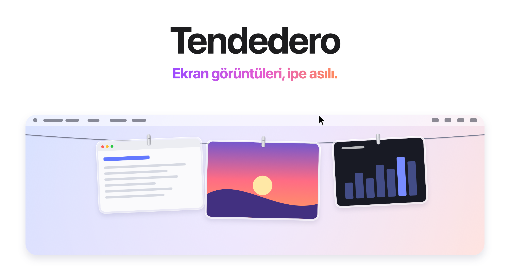
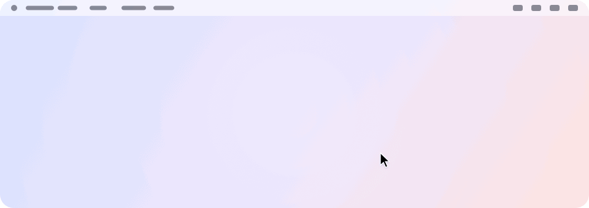
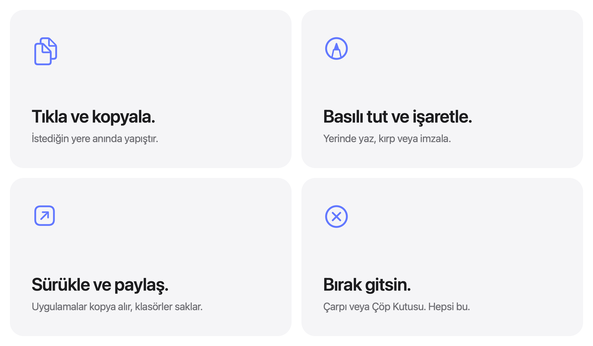

<picture>
  <source media="(prefers-color-scheme: dark)" srcset="../images/tr/hero-dark.png">
  
</picture>

<h3 align="center"><a href="https://tendedero.app">tendedero.app adresinde tarayıcıdan deneyin&nbsp;&rsaquo;</a></h3>

<p align="center">
  Ücretsiz ve açık kaynak. macOS 14 ve sonrası için.
  <br>
  <a href="../../../../releases/latest">İndir&nbsp;&rsaquo;</a>
  &nbsp;&nbsp;
  <a href="#kaynaktan-derle">Kaynaktan derle&nbsp;&rsaquo;</a>
  <br><br>
  <a href="../../README.md">English</a>&nbsp;·&nbsp;<a href="README.es.md">Español</a>&nbsp;·&nbsp;<a href="README.gl.md">Galego</a>&nbsp;·&nbsp;<a href="README.fr.md">Français</a>&nbsp;·&nbsp;<a href="README.pt-BR.md">Português (Brasil)</a>&nbsp;·&nbsp;<a href="README.ja.md">日本語</a>&nbsp;·&nbsp;<a href="README.ko.md">한국어</a>&nbsp;·&nbsp;<a href="README.zh-Hans.md">简体中文</a>&nbsp;·&nbsp;Türkçe&nbsp;·&nbsp;<a href="README.az.md">Azərbaycanca</a>&nbsp;·&nbsp;<a href="README.hi.md">हिन्दी</a>
  <br>
  <sub>Bu dosya İngilizce README'nin çevirisidir. Bir tutarsızlık varsa İngilizce sürümü esas alın.</sub>
</p>

<p align="center">
  <a href="https://trendshift.io/repositories/287033?utm_source=trendshift-badge&amp;utm_medium=badge&amp;utm_campaign=badge-trendshift-287033" target="_blank" rel="noopener noreferrer"></a>
  <a href="https://trendshift.io/repositories/287033?utm_source=trendshift-badge&amp;utm_medium=badge&amp;utm_campaign=badge-trendshift-287033" target="_blank" rel="noopener noreferrer"></a>
</p>

<br>

## Gözden uzak. Her an erişilebilir.

Aldığınız her ekran görüntüsü, ekranınızın hemen üstündeki bir ipe asılır.
İşaretçiyi menü çubuğuna götürün, ip aşağı süzülür. Uzaklaşın, kaybolur.

<picture>
  <source media="(prefers-color-scheme: dark)" srcset="../images/tr/demo-dark.gif">
  
</picture>

<br>
<br>

## Her şey için bir hareket.

<picture>
  <source media="(prefers-color-scheme: dark)" srcset="../images/tr/bento-dark.png">
  
</picture>

<br>
<br>

| | |
|:--|:--|
| Tıkla | Görüntüyü kopyalar. |
| Basılı tut | İşaretle'de açar. |
| Çift tıkla | Önizleme'de açar. |
| Kuvvetli tıkla | Hızlı Bakış ile önizler. |
| Uygulamaya sürükle | Bir kopya gönderir. İpte kalmaya devam eder. |
| Klasöre sürükle | Orada saklar. İpten ayrılır. |
| Çöp Kutusu'na sürükle ya da çarpıya tıkla | Siler. |
| İşaretçiyi menü çubuğunda bırak | O ekranda ipi aşağı indirir. |
| Menü çubuğunda herhangi bir yere tıkla | İpi geri kaldırır. |
| <kbd>⌃</kbd>&thinsp;<kbd>⌥</kbd>&thinsp;<kbd>T</kbd> | İpi gösterir ya da gizler. Menü çubuğundaki Kısayol bölümünden değiştirilebilir. |

<br>

## Masaüstünüz. Sonunda temiz.

Ekran görüntülerinizi Tendedero'ya bırakın<sup>1</sup>; Masaüstünü hiç görmeden geçsinler.
Kayan küçük resim yok. Beş saniyelik bekleme yok. Her görüntü çekildiği an ipe asılır;
yalnızca sürükleyip çıkardıklarınız saklanır.

Ekran kayıtları da üzerlerinde bir oynatma düğmesiyle ipe asılır.
Kırpmak için bir tanesine basılı tutun.

Aynı kısayollar. Aynı kas belleği. Sadece daha az dağınıklık.

<br>

## Kopyalanan görseller de dahil.

<kbd>⌃</kbd> tuşunu basılı tutarak ekran görüntüsü alın ya da Önizleme'de bir görsel kopyalayın;
herhangi bir görüntü gibi ipe asılır. Menü çubuğundan Kopyalanan görselleri as seçeneğini açın;
bu açıkken simgedeki gömlek dolar. Yalnızca görseller: metin veya bir dosyayla birlikte kopyalanan
içerik ve bir şifre yöneticisinin özel olarak işaretlediği her şey olduğu gibi bırakılır.

<br>

## Tasarımdan gelen gizlilik.

Hesap yok. Ağ erişimi yok. Analitik yok.
Tendedero tamamen Mac'inizde çalışır ve ekran görüntüleriniz hiçbir zaman oradan ayrılmaz.

<br>

## Teknik Özellikler

| | |
|:--|:--|
| **Uyumluluk** | macOS 14 Sonoma veya sonrası, Apple silicon ve Intel. macOS 27 için tasarlandı. |
| **Boyut** | 1,7 MB |
| **Diller** | İngilizce, İspanyolca, Galiçyaca, Fransızca, Portekizce (Brezilya), Japonca, Korece, Basitleştirilmiş Çince, Türkçe, Azerice, Hintçe |
| **Yapıldığı teknolojiler** | Swift, AppKit ve SwiftUI |
| **Ağ erişimi** | Yok |
| **Fiyat** | Ücretsiz |
| **Lisans** | Kod için MIT. Ad ve simge dahil değil. |

<br>

## Kur

[Son sürümden](../../../../releases/latest) disk imajını indirin, açın ve Tendedero'yu
Uygulamalar'a sürükleyin. Ya da Homebrew ile yükleyin:

```sh
brew install --cask alejandrobujan/tap/tendedero
```

Tendedero, Developer ID ile imzalı ve Apple tarafından onaylıdır; diğer uygulamalar gibi açılır.

<br>

## Kaynaktan derle

```sh
git clone git@github.com:alejandrobujan/tendedero.git
cd tendedero
scripts/build-app.sh
open build/Tendedero.app
```

Swift araç zinciri gereklidir; Xcode isteğe bağlıdır. macOS 27 Komut Satırı Araçları ile script,
yanlarında yüklenen macOS 26 SDK'ya geri döner; çünkü yeni SDK, yalnızca Xcode'un sunduğu bir
SwiftUI makro eklentisi gerektirir. Yerel derlemeler ad-hoc imzalanır, bu yüzden her yeniden
derlemeden sonra macOS Masaüstü erişimi için tekrar izin ister.

<details>
<summary>Uygulamanın içinde</summary>
<br>

| Dosya | Görevi |
|:--|:--|
| `AppDelegate.swift` | Menü çubuğu, kısayol, ipi indirme ve kaldırma |
| `LinePanel.swift` | Ekranın üst kenarındaki şeffaf şerit |
| `LineView.swift` | İp ve her fotoğrafın asıldığı yer |
| `PeggedView.swift` | Bir fotoğraf: cam çerçeve, mandal, sallantı ve esinti |
| `GrabArea.swift` | Tıklama, uzun basış, sürükle ve bırak |
| `ScreenshotWatcher.swift` | Yeni ekran görüntülerini fark eder |
| `ClipboardWatcher.swift` | Panoya kopyalanan görselleri fark eder |
| `Inbox.swift` | Ekran görüntüsü ayarlarını devralır ve geri verir |
| `Markup.swift` | Sistem İşaretle düzenleyicisini açar ve sonucu kaydeder |
| `Trim.swift` | Ekran kaydını kırpar ve sonucu kaydeder |
| `FullScreen.swift` | Ne zaman gizli kalınacağını bilir |
| `Line.swift` | Asılı olanlar ve bunlarla neler yapılabileceği |

Buradaki her görsel, simge dahil, `scripts/make-icon.swift` ve
`scripts/make-readme-art.swift` tarafından kod ile çizilir.
`scripts/make-dmg.sh` sürümler için disk imajı oluşturur.

Çeviriler `Sources/Tendedero/Resources` altında, her dil için bir `.lproj` klasöründe yer alır.
`swift scripts/check-strings.swift` eksik çevirileri kontrol eder.

</details>

<br>

---

<sub>
1. İlk açılışta Tendedero, ekran görüntülerinizi yönetmek isteyip istemediğinizi sorar. Kabul ederseniz kayan küçük resmi kapatır ve yeni görüntüleri kendi klasörüne kaydeder; bunlar Cmd+Shift+5 Seçenekler menüsünde de bulunan iki ayardır. Önceki ayarlarınız kaydedilir ve Tendedero kapandığında ya da seçenek menü çubuğundan kapatıldığında geri yüklenir. Bir uygulama tam ekranda çalışırken Tendedero otomatik olarak gizlenir.
</sub>

<br>
<br>

<p align="center">
  
  <br>
  <sub>Kod MIT lisansı ile sunulmaktadır. Tendedero adı ve simgesi lisansa dahil değildir; bu nedenle fork'ların kendi adına ve simgesine ihtiyacı vardır. Ayrıntılar için <a href="../../LICENSE">LICENSE</a>'a bakın.</sub>
  <br>
  <sub><a href="https://alejandrobujan.com">Alejandro Buján</a> tarafından tasarlanıp geliştirilmiştir.</sub>
</p>
