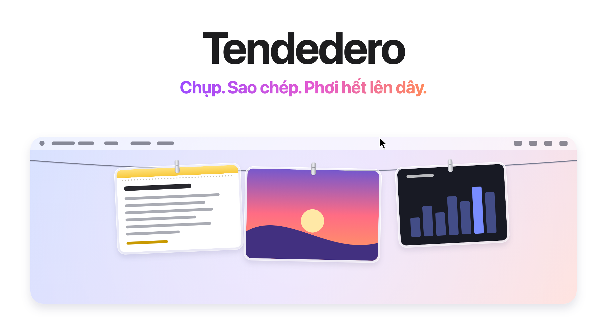
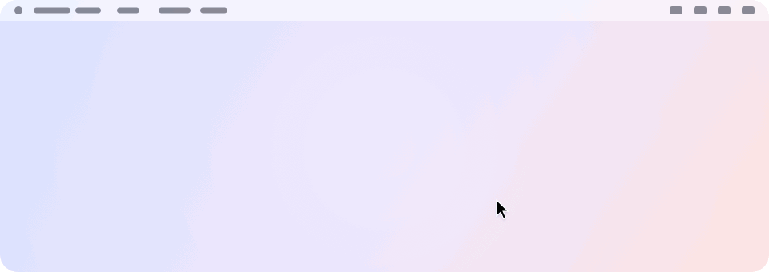
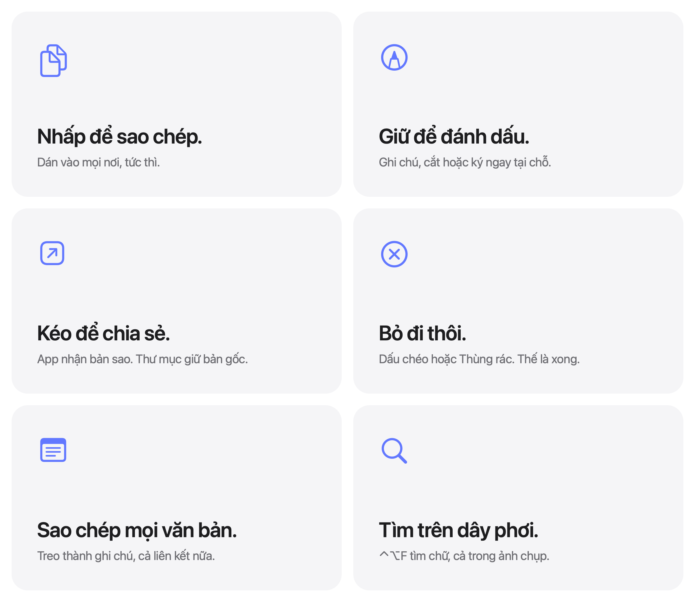

<picture>
  <source media="(prefers-color-scheme: dark)" srcset="../images/vi/hero-dark.png">
  
</picture>

<h3 align="center"><a href="https://tendedero.app">Dùng thử ngay trên trình duyệt tại tendedero.app&nbsp;&rsaquo;</a></h3>

<p align="center">
  Miễn phí và mã nguồn mở. Dành cho macOS 14 trở lên.
  <br>
  <a href="../../../../releases/latest">Tải xuống&nbsp;&rsaquo;</a>
  &nbsp;&nbsp;
  <a href="#tự-biên-dịch-từ-mã-nguồn">Tự biên dịch từ mã nguồn&nbsp;&rsaquo;</a>
  <br><br>
  <a href="../../README.md">English</a>&nbsp;·&nbsp;<a href="README.es.md">Español</a>&nbsp;·&nbsp;<a href="README.gl.md">Galego</a>&nbsp;·&nbsp;<a href="README.fr.md">Français</a>&nbsp;·&nbsp;<a href="README.pt-BR.md">Português (Brasil)</a>&nbsp;·&nbsp;<a href="README.it.md">Italiano</a>&nbsp;·&nbsp;<a href="README.ja.md">日本語</a>&nbsp;·&nbsp;<a href="README.ko.md">한국어</a>&nbsp;·&nbsp;<a href="README.zh-Hans.md">简体中文</a>&nbsp;·&nbsp;<a href="README.tr.md">Türkçe</a>&nbsp;·&nbsp;<a href="README.az.md">Azərbaycanca</a>&nbsp;·&nbsp;<a href="README.hi.md">हिन्दी</a>&nbsp;·&nbsp;Tiếng Việt
  <br>
  <sub>Bản dịch từ README tiếng Anh. Nếu có khác biệt, bản tiếng Anh là bản chuẩn.</sub>
</p>

<p align="center">
  <a href="https://trendshift.io/repositories/287033?utm_source=trendshift-badge&amp;utm_medium=badge&amp;utm_campaign=badge-trendshift-287033" target="_blank" rel="noopener noreferrer"></a>
  <a href="https://trendshift.io/repositories/287033?utm_source=trendshift-badge&amp;utm_medium=badge&amp;utm_campaign=badge-trendshift-287033" target="_blank" rel="noopener noreferrer"></a>
</p>

<br>

## Khuất tầm mắt. Ngay tầm tay.

Mỗi ảnh chụp màn hình bạn tạo ra, và mọi thứ bạn sao chép, đều được treo trên một sợi dây ngay phía trên màn hình.
Đặt con trỏ ở giữa thanh menu, dây phơi sẽ trượt xuống. Di chuột ra ngoài, dây phơi tự ẩn đi.

<picture>
  <source media="(prefers-color-scheme: dark)" srcset="../images/vi/demo-dark.gif">
  
</picture>

<br>
<br>

## Mỗi thao tác một cử chỉ.

<picture>
  <source media="(prefers-color-scheme: dark)" srcset="../images/vi/bento-dark.png">
  
</picture>

<br>
<br>

| | |
|:--|:--|
| Nhấp chuột | Sao chép. Ghi chú thì sao chép văn bản, giữ nguyên định dạng. |
| Nhấn và giữ | Mở trong công cụ Đánh dấu (Markup). Ghi chú thì mở ra để chỉnh sửa. |
| Nhấp đúp | Mở trong Preview (Xem trước). Liên kết thì mở trong trình duyệt. |
| Nhấn mạnh (Force click) | Mở bằng Xem nhanh (Quick Look). |
| Kéo vào một ứng dụng | Gửi một bản sao. Mục đó vẫn ở trên dây. |
| Kéo vào một thư mục | Lưu tại đó. Mục đó rời khỏi dây. |
| Kéo vào Thùng rác, hoặc nhấp dấu chéo | Bỏ đi. |
| Shift + nhấp chuột | Chọn nhiều mục. Menu của chúng, <kbd>⌘</kbd>&thinsp;<kbd>C</kbd>, <kbd>⌫</kbd> và thao tác kéo áp dụng cho tất cả. <kbd>Esc</kbd> hoặc một cú nhấp thường sẽ bỏ chọn. |
| <kbd>⌘</kbd>&thinsp;<kbd>Z</kbd> khi đặt con trỏ trên dây | Hoàn tác thao tác vừa làm: bỏ đi, ghim hoặc lưu vào Màn hình nền, kể cả một vùng chọn. |
| <kbd>Space</kbd> khi đặt con trỏ trên ảnh | Xem nhanh. |
| <kbd>⌫</kbd> khi đặt con trỏ trên ảnh | Bỏ đi, tương tự nút ở góc ảnh. |
| Nhấp chuột phải, chọn Chia sẻ | Gửi qua AirDrop, Tin nhắn, Mail và nhiều ứng dụng khác. Ảnh vẫn ở trên dây. |
| Nhấp chuột phải, chọn Ghim | Giữ ảnh lại: ảnh được treo bên trái nút thắt bằng kẹp màu xám không gian và không bị ảnh mới đẩy ra khỏi dây. |
| Nhấp chuột phải, chọn Giữ trên tay | Nhấc ảnh khỏi dây và giữ nổi ngay trước mặt trong lúc bạn làm việc. Ghi chú đang giữ là văn bản bạn có thể chọn. |
| Trong Finder, nhấp chuột phải vào ảnh hoặc tệp văn bản, chọn Treo lên Tendedero | Treo lên dây ở trạng thái đã ghim. |
| Đặt con trỏ lên một ảnh khi đã bật Phóng to khi di chuột | Xem ảnh lớn hơn ở giữa màn hình. |
| Đặt con trỏ ở giữa thanh menu | Kéo dây phơi xuống trên màn hình đó. |
| Nhấp vào bất kỳ đâu trên thanh menu | Thu gọn dây phơi. |
| <kbd>⌃</kbd>&thinsp;<kbd>⌥</kbd>&thinsp;<kbd>T</kbd> | Hiện hoặc ẩn dây phơi. Đổi phím tắt tại mục Phím tắt trên thanh menu. |
| <kbd>⌃</kbd>&thinsp;<kbd>⌥</kbd>&thinsp;<kbd>F</kbd> | Tìm trên dây phơi. |

<br>

## Màn hình nền của bạn. Cuối cùng cũng gọn gàng.

Giao ảnh chụp màn hình cho Tendedero<sup>1</sup> và chúng sẽ không bao giờ tràn ra
Màn hình nền (Desktop). Không còn hình thu nhỏ nổi. Không phải chờ năm giây. Mỗi ảnh
đều được treo lên dây ngay khoảnh khắc bạn chụp, và chỉ những ảnh bạn kéo ra ngoài mới được giữ lại.

Bản ghi màn hình cũng được treo lên dây cùng nút phát phía trên.
Nhấn giữ một bản ghi để cắt đoạn.

Vẫn những phím tắt quen thuộc. Vẫn thói quen cũ. Chỉ ít bừa bộn hơn.

<br>

## Cả văn bản, liên kết và hình ảnh đã sao chép.

Bật từng loại tại mục Treo nội dung đã sao chép trên thanh menu; khi có loại nào đang bật,
biểu tượng chiếc áo sẽ được tô đậm.

Văn bản đã sao chép được treo thành một ghi chú, như một trang Ghi chú trong cùng khung kính:
dòng đầu tiên là tiêu đề, Markdown hiển thị có định dạng và mã nguồn giữ nguyên từng dòng.
Một địa chỉ web được treo thành liên kết, kèm tên trang và đường dẫn. Chụp màn hình khi giữ
phím <kbd>⌃</kbd>, hoặc sao chép một hình ảnh trong Preview, ảnh đó cũng được treo như bình thường.

Không lưu lại bất cứ thứ gì từ ô nhập mật khẩu, từ dữ liệu được trình quản lý mật khẩu đánh dấu
riêng tư, hay từ thiết bị khác qua Bảng nhớ tạm chung (Universal Clipboard).

<br>

## Tìm mọi thứ trên dây phơi.

Nhấn <kbd>⌃</kbd>&thinsp;<kbd>⌥</kbd>&thinsp;<kbd>F</kbd> và gõ. Chỉ những mục khớp mới ở lại
trên dây: chữ trong ảnh chụp màn hình, được đọc ngay trên máy Mac lúc ảnh được treo, và chữ
của mọi ghi chú và liên kết. <kbd>Return</kbd> sao chép kết quả khớp mới nhất.

<br>

## Riêng tư ngay từ thiết kế.

Không tài khoản. Không kết nối mạng. Không thu thập dữ liệu.
Tendedero chạy hoàn toàn trên máy Mac của bạn, kể cả việc đọc chữ trong ảnh chụp,
và không gì bạn treo lên dây rời khỏi máy.

<br>

## Thông số kỹ thuật

| | |
|:--|:--|
| **Tương thích** | macOS 14 Sonoma trở lên, hỗ trợ Apple silicon và Intel. Thiết kế cho macOS 27. |
| **Dung lượng** | 5,1 MB |
| **Ngôn ngữ** | Tiếng Anh, Tây Ban Nha, Galicia, Pháp, Bồ Đào Nha (Brazil), Ý, Nhật, Hàn, Trung giản thể, Thổ Nhĩ Kỳ, Azerbaijan, Hindi, Việt |
| **Công nghệ** | Swift, AppKit và SwiftUI |
| **Truy cập mạng** | Không |
| **Giá** | Miễn phí |
| **Giấy phép** | MIT cho mã nguồn. Tên gọi và biểu tượng không nằm trong giấy phép này. |

<br>

## Cài đặt

Tải tệp ảnh đĩa từ [bản phát hành mới nhất](../../../../releases/latest),
mở tệp và kéo Tendedero vào thư mục Ứng dụng (Applications). Hoặc cài đặt bằng Homebrew:

```sh
brew install tendedero
```

Tendedero đã được ký bằng Developer ID và chứng thực (notarized) bởi Apple, nên ứng dụng mở lên
như mọi phần mềm macOS thông thường khác.

<br>

## Tự biên dịch từ mã nguồn

```sh
git clone git@github.com:alejandrobujan/tendedero.git
cd tendedero
scripts/build-app.sh
open build/Tendedero.app
```

Cần bộ công cụ Swift; Xcode không bắt buộc. Với Command Line Tools cho macOS 27, script sẽ tự
chuyển về dùng SDK macOS 26 đi kèm, vì SDK mới cần một plugin macro SwiftUI chỉ có trong Xcode.
Các bản dựng nội bộ được ký kiểu ad hoc, nên macOS sẽ hỏi lại quyền truy cập Màn hình nền sau mỗi lần biên dịch lại.

Bạn muốn đóng góp? Hãy đọc [CONTRIBUTING.md](../../CONTRIBUTING.md) trước.

<details>
<summary>Bên trong ứng dụng</summary>
<br>

| Tệp | Vai trò |
|:--|:--|
| `AppDelegate.swift` | Thanh menu, phím tắt, hiện và thu gọn dây phơi |
| `LinePanel.swift` | Dải cửa sổ trong suốt dọc theo cạnh trên màn hình |
| `LineView.swift` | Sợi dây phơi và vị trí treo từng ảnh |
| `PeggedView.swift` | Từng bức ảnh hoặc ghi chú: khung kính, kẹp nhôm, độ đung đưa và làn gió |
| `GrabArea.swift` | Nhấp chuột, nhấn giữ, kéo và thả |
| `ScreenshotWatcher.swift` | Phát hiện ảnh chụp màn hình mới |
| `ClipboardWatcher.swift` | Phát hiện hình ảnh, văn bản và liên kết được sao chép vào bảng nhớ tạm |
| `NoteSheet.swift` | Vẽ văn bản đã sao chép thành một trang Ghi chú |
| `Markdown.swift` | Markdown trong ghi chú |
| `Inbox.swift` | Tiếp quản cài đặt ảnh chụp màn hình và khôi phục lại |
| `Markup.swift` | Mở trình chỉnh sửa Đánh dấu của hệ thống và lưu kết quả |
| `Trim.swift` | Cắt bản ghi màn hình và lưu kết quả |
| `FullScreen.swift` | Nhận biết khi nào cần giữ dây phơi ở trạng thái ẩn |
| `Line.swift` | Quản lý những gì đang treo trên dây và các thao tác tương ứng |
| `Held.swift` | Giữ một bức ảnh ngay trước mặt, tách khỏi dây phơi |
| `SearchIndex.swift` | Đọc chữ trong ảnh chụp, ngay trên máy Mac này, để tìm kiếm |
| `SearchBar.swift` | Ô tìm kiếm bên dưới dây phơi |
| `Zoom.swift` | Bản phóng to của một ảnh khi di chuột |
| `Share.swift` | Chia sẻ, từ menu của một ảnh |

Mọi hình ảnh minh họa tại đây, kể cả biểu tượng ứng dụng, đều được vẽ bằng mã nguồn qua
`scripts/make-icon.swift` và `scripts/make-readme-art.swift`.
`scripts/make-dmg.sh` đóng gói tệp ảnh đĩa cho các bản phát hành.

Các bản dịch nằm trong `Sources/Tendedero/Resources`, mỗi ngôn ngữ một thư mục `.lproj`.
Chạy `swift scripts/check-strings.swift` để kiểm tra không còn chuỗi nào bị thiếu.

</details>

<br>

---

<sub>
1. Trong lần khởi chạy đầu tiên, Tendedero sẽ đề nghị quản lý ảnh chụp màn hình cho bạn. Nếu đồng ý, ứng dụng sẽ tắt hình thu nhỏ nổi và lưu ảnh chụp mới vào thư mục riêng — hai cài đặt này cũng có thể tìm thấy trong mục Tùy chọn (Options) của tổ hợp phím Cmd+Shift+5. Các cài đặt trước đó của bạn được lưu lại và tự động khôi phục khi thoát Tendedero hoặc tắt tùy chọn này từ thanh menu. Tendedero tự động ẩn khi có ứng dụng đang chạy ở chế độ toàn màn hình.
</sub>

<br>
<br>

<p align="center">
  
  <br>
  <sub>Mã nguồn phát hành theo giấy phép MIT. Tên gọi và biểu tượng Tendedero không thuộc giấy phép này, nên các bản fork cần dùng tên và biểu tượng riêng. Xem <a href="../../LICENSE">LICENSE</a>.</sub>
  <br>
  <sub>Thiết kế và phát triển bởi <a href="https://alejandrobujan.com">Alejandro Buján</a>.</sub>
</p>
